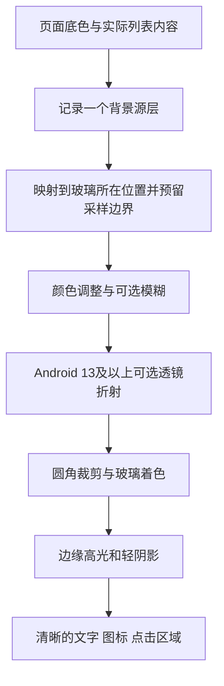

# “日常”安卓液态玻璃效果实现说明

> 本文归入技术研究，保留视频拆解、采样分层、后端候选和早期原型参数。正文中的旧三入口、紧凑布局及尺寸已由 [UI/UX V3](../iOS风格安卓UI与UX动效设计_V3.md) 替代；正式工程以 [工程指南](../安卓本地版工程结构与开发指南.md) 为准，不将候选库视为已接入。

版本：1.1 · 2026-10-24。对象：个人离线安卓 App，日常待办＋随手记录；采用已选中的“紧凑清单”布局。主要目标机：用户确认的 OPPO Find X9 Pro。按最新反馈，全组件统一玻璃风格，底部改为常规固定三栏导航。

## 1. 先确定我们要实现什么

**可以使用原生 Kotlin＋Jetpack Compose 实现视频里的主要视觉和交互。当前方案让全部组件采用统一玻璃材质、柔和彩光和细高光边缘；底部导航固定三个等宽入口，图标在上、文字在下。Android 13 及以上再按性能增加背景折射。**

现有 Room、本地备份、DataStore 和页面业务设计继续使用。玻璃是一层可替换的绘制能力，不需要服务器、账号、AI 服务或新的数据存储方案。

这次完成的是参考素材核对、原生实现设计和基础材质示例。正式业务 App 尚未创建；本文中的增强效果和性能指标是实现要求，不是已经完成的真机测试结果。

## 2. 实际看过的视频内容

提供的视频为 18 秒，2560×1920，视频流标记 60fps。已提取关键帧，见 [视频关键帧总览](../../references/liquid-glass/video-contact-sheet.jpg)。视频编码帧率不能证明其原始界面的实时渲染帧率。

| 大致区间 | 实际画面 | 原生安卓需要实现的部分 |
| --- | --- | --- |
| 0～4 秒 | 当前导航项展开文字，选中项呈浅灰透明胶囊，图标切换颜色，其余入口让位 | 选中状态、宽度／位置过渡、胶囊材质、图标着色 |
| 5～11 秒 | 三条浅玻璃横条，柔和蓝紫／薄荷彩光移动，边缘有很淡的反光 | 独立渐变装饰层、圆角裁剪、边缘高光、短暂出入场 |
| 12～18 秒 | 信息卡片从未登录切换为示例账号／权益状态 | 内容切换、淡入和尺寸适配、浅玻璃卡片 |

放大参考：[导航约 1 秒](../../references/liquid-glass/video-frames/nav-01s.jpg)、[横条约 8 秒](../../references/liquid-glass/video-frames/bars-08s.jpg)、[卡片约 16 秒](../../references/liquid-glass/video-frames/card-16s.jpg)。

视频主要是在近白色背景上展示很轻的玻璃感。仅凭这些画面，无法确认原界面有没有真实背景折射，也无法得知原始源代码和渲染框架。我们能明确复现的是可见外观和状态过渡；不能把“看起来通透”直接认定为物理光学渲染。

视频中的账号是展示内容。我们的个人 App 无需登录，不因此增加账号、付费权益或会员页面。

## 3. ZIP 资源包可以怎样使用

已将资源包安全解压到 [本地参考目录](../../references/liquid-glass/ui-atlas-kit/README.md)，只阅读内容，没有执行其脚本。该包是 9 个 HTML、CSS、JavaScript 和说明文件组成的 Web 原型，没有安卓工程、Gradle 配置、Compose 组件或本地数据库。

最相关的文件：

- `reference.html`：独立的约 18 秒视频近似复刻，包含导航、横条和状态卡片。
- `gallery.css`：玻璃背景、边缘、阴影和装饰动效。
- `gallery.js`：导航、卡片和按钮等交互参考。
- `atlas.css`、`atlas.js`：多主题与扩展组件；第一版不用照搬整个组件库。

包内 [README](../../references/liquid-glass/ui-atlas-kit/README.md) 第 82 行明确写着：“玻璃效果是渐变、模糊、高光和阴影的视觉模拟，没有物理折射或色散。”实际样式也使用了 `backdrop-filter`、渐变、边框和阴影；没有发现用 AGSL 或透镜位移 Shader 实现的原生渲染器。

可以迁移材质参数、组件状态和动画节奏。HTML／CSS／JavaScript 文件需要重写成 Compose；它们无法直接变成原生安卓控件。包内的运行建议、验证记录和其它说明只作为参考材料，其声称的测试结果不代表我们的安卓项目已通过测试。

## 4. HTML 效果与安卓实现的对应关系

| Web 中常见做法 | 原生 Compose 对应做法 | 需要注意什么 |
| --- | --- | --- |
| 半透明背景色 | 背景绘制层使用 `Color.copy(alpha = …)` | 不对整个控件降低 alpha，否则文字也会变淡 |
| `linear-gradient`／`radial-gradient` | `Brush.linearGradient`／`Brush.radialGradient`，配合 Canvas | 只绘制装饰层，不让文字一起模糊 |
| `border-radius` | `RoundedCornerShape`、`CircleShape` 和裁剪 | 胶囊可用半高圆角；触摸区域仍要足够大 |
| 边框、内高光和 `box-shadow` | 渐变描边、顶部亮边、外阴影和额外内侧绘制 | 内阴影不是普通 elevation 的直接等价物 |
| `backdrop-filter: blur(…)` | 记录背景源，然后对背景副本使用 RenderEffect 或背景效果库 | 普通 `Modifier.blur()` 主要处理自身绘制内容，不能自动读取背后的其它控件 |
| CSS `transform`、transition | `graphicsLayer`、`Animatable`、`animate*AsState`、spring／tween | 位移和缩放尽量在绘制层更新；真实尺寸变化才做布局动画 |
| hover 追光、鼠标倾斜 | 按压位置高光、轻微缩放；必要时处理触摸位置 | 手机没有持续鼠标悬停，不要求用户拖动才能看懂控件 |
| SVG 位移／WebGL 透镜效果 | AGSL `RuntimeShader` 对已获取的背景像素改变采样位置 | 需要背景输入和坐标映射，不是加一个“液态玻璃”开关 |

`RenderEffect.createBlurEffect` 从 API 31 提供；`createRuntimeShaderEffect` 从 API 33 提供，它们处理的是指定 RenderNode 的输入内容。[Android RenderEffect API](https://developer.android.com/reference/android/graphics/RenderEffect)

因此，把 `Modifier.blur(16.dp)` 加在一个包含文字和按钮的整个卡片上，得到的是被模糊的卡片，不会自动得到清晰文字下的磨砂玻璃。

## 5. 两层实现目标与选型建议

### A. 首版默认：复现视频的浅玻璃外观

采用 Compose 自绘背景、低饱和渐变、细边缘、柔和阴影和短动画。背景没有明显图案时，这些因素比大半径模糊更能决定视频里的观感。

这一层不依赖第三方玻璃库，能够在当前 minSdk 26 方案上实现。基础材质本身不提供实时背景模糊或折射；在静态近白背景上仍然可以有接近视频的浅玻璃外观。

用 `SoftGlassSurface` 统一材质，封装 `GlassNavigation`、`GlassFilterBar`、`GlassActionButton`、`GlassTaskRow`、`GlassNoteCard`、`GlassTextField`、`GlassCheckbox`、`GlassSwitch`、`GlassSettingRow`、`GlassSheet` 和 `GlassToast`。全部组件具有相同高光、着色和边缘体系；任务正文、记录正文及输入区采用遮盖度更高的玻璃着色，文字和光标最后清晰绘制。

全组件玻璃风格与逐组件实时折射是两个独立维度。原生小控件可复用着色和边缘绘制，导航等需要看到内容经过的区域再增加背景采样；同一套视觉规范可以适配不同的绘制成本。

### B. 增强层：背景真的随玻璃发生变形

当你希望列表从底部导航后面滚过时出现弯曲、放大或边缘透镜感，再增加实时背景源和折射渲染。

优先评估 **Backdrop**，理由是它的源层、效果层和透镜能力与我们要做的底部导航直接对应。当前官方用法是 `rememberLayerBackdrop`／`Modifier.layerBackdrop`／`Modifier.drawBackdrop`；效果包含 blur 和 lens。它提供绘制基础，高层导航、按钮和业务状态需要我们自己封装。[Backdrop 入门](https://kyant.gitbook.io/backdrop)、[组件项目](https://github.com/Kyant0/AndroidLiquidGlass)

**Haze** 是可选方案，目前文档已经包含 `haze-glass`，不能简单理解成只有模糊。它同样区分来源内容和自身内容，并提供玻璃材质及兼容回退。[Haze Glass 说明](https://chrisbanes.github.io/haze/latest/effects/glass/)

一个工程先选一个背景效果后端，避免同一片区域重复捕获与叠加两套模糊。所有后端都放进自己的 `ui/glass` 封装，页面只使用我们的组件。

### 版本管理

当前本机已验证基线为 Kotlin 2.2.10、AGP 8.12.2、Gradle 8.13、Compose BOM 2025.08.00、compileSdk／targetSdk 36、minSdk 26。

这些验证只能证明原有环境项目可构建，**不能证明随手添加最新玻璃库也能构建**。本次查看到的 Backdrop `kmp` 分支版本目录使用 Kotlin 2.4.10／Compose Multiplatform 1.12.0，构建源码的 Android 配置为 compileSdk 37。这是该分支自己的构建环境，不等于已经发布的每个 AAR 都要求完全相同的工具链。[版本目录](https://github.com/Kyant0/AndroidLiquidGlass/blob/kmp/gradle/libs.versions.toml)、[模块构建配置](https://github.com/Kyant0/AndroidLiquidGlass/blob/kmp/backdrop/build.gradle.kts)

接入时应选定实际发布版本，检查它的 POM、AAR metadata、Kotlin 元数据和依赖解析结果，再固定到版本目录。不要使用动态版本 `+`，也不要把旧教程的 JitPack 坐标和新文档 API 混用。Haze 仓库 README 与更新日志对发布状态存在不同步的描述，同样以实际发布制品和对应版本文档为准。本次没有给业务工程添加这些依赖，也没有为了查看效果升级本机工具链。

## 6. 原生玻璃的正确分层



重要的是背景源层与玻璃层是分开的：记录底色和列表，玻璃读取这个来源，文字最后绘制。不能把玻璃自己重新记录进自己的来源，否则可能出现重复叠影或反馈。

背景源要覆盖真实可见的底色；只记录局部内容而漏掉底色，透镜边缘可能采样到透明像素。模糊和折射会读取玻璃边界之外的像素，需要保留额外采样区域，最后再按形状裁剪。单纯把背景截成控件大小后再强行折射，容易出现黑边、透明缝或拉伸边。

来源坐标与效果坐标必须一致。滚动、导航动画、横竖屏、状态栏／导航栏 Insets、键盘出现时都要重新核对。可使用效果库已有的坐标转换能力；自行实现时需要维护局部坐标到背景源坐标的变换。

`RuntimeShader` 支持传入参数和输入 Shader；`RenderEffect` 可以把其图层原始绘制内容传给 Shader。它不会自动获取任意兄弟控件、其它窗口或整台手机屏幕的像素。[AGSL 使用说明](https://developer.android.com/develop/ui/views/graphics/agsl/using-agsl)

## 7. 基础材质示例怎么用

已附独立的 [SoftGlassSurface.kt](../../examples/liquid-glass/SoftGlassSurface.kt)。它负责透明渐变、静态柔光和描边，内部内容保持清晰；不包含实时背景捕获、模糊、折射、点击业务和持久化。已在现有环境工程中临时添加该源目录，离线执行 Kotlin 编译，结果成功；未改动工程的持久构建配置。详细边界见 [示例说明](../../examples/liquid-glass/README.md)。

示意用法：

```kotlin
SoftGlassSurface(
    modifier = Modifier.fillMaxWidth(),
    shape = RoundedCornerShape(24.dp),
) {
    Row(Modifier.padding(horizontal = 20.dp, vertical = 16.dp)) {
        Text("今天还有 3 件事")
    }
}
```

该材质需要放在受控的浅／深页面背景上。将它直接放在高对比照片上时，必须提高底色遮盖度，保证文字可读。绘制函数本身不代替按钮、导航项或复选框的无障碍语义。

## 8. 真实背景效果的接线方式

以下是按当前 Backdrop 文档整理的**结构示意**，用于说明来源和玻璃的关系；省略 import、导航内容和具体发布版本，不能视为已经通过本机编译的完整工程：

```kotlin
val backdrop = rememberLayerBackdrop {
    drawRect(pageBackground)
    drawContent()
}

Box(Modifier.fillMaxSize()) {
    MainContent(Modifier.layerBackdrop(backdrop))

    Box(
        Modifier
            .align(Alignment.BottomCenter)
            .navigationBarsPadding()
            .padding(16.dp)
            .drawBackdrop(
                backdrop = backdrop,
                shape = { RoundedCornerShape(28.dp) },
                effects = {
                    blur(10.dp.toPx())
                    if (Build.VERSION.SDK_INT >= 33) {
                        lens(8.dp.toPx(), 12.dp.toPx())
                    }
                },
            )
    ) {
        NavigationForeground() // 清晰文字和可访问的点击控件
    }
}
```

这段结构只在已经按设备能力选择背景效果后端的分支中使用。低于 API 31 的设备直接走基础材质分支；不能只判断 lens，却让不支持的机器继续进入依赖 RenderEffect 的路径。来源及玻璃的尺寸、状态保存、内容底部留白和完整深色材质还需要业务组件处理。

效果顺序为颜色处理 → blur → lens，再合成高光与前景。Backdrop 当前文档把普通背景效果列为 Android 12 起可用，lens 需要 Android 13，透镜形状要求 `CornerBasedShape`。上面 10dp、8dp、12dp 是调试起点，不是视频测出的物理数值。[效果 API 与要求](https://kyant.gitbook.io/backdrop/api/backdrop-effects)、[底部栏教程](https://kyant.gitbook.io/backdrop/tutorials/glass-bottom-bar)

公开参数统一使用 dp 表达材质尺寸；传入 Android 绘制／Shader 或要求像素的库方法前转换为 px。不能把网页里的 `12px` 原样当成所有手机上的 `12px`，否则密度变化后效果强度不同。

## 9. 如果自己写 AGSL，折射具体做什么

增强渲染的核心不是让整块 UI 弯曲，而是改变背景的采样位置。一个简化的设计关系是：

```text
q = 当前像素在玻璃内部的位置
d = q 到圆角形状边缘的有符号距离
n = 形状边缘的局部法线方向
offset = n × 边缘权重(d) × 折射强度
glassColor = 背景源采样(映射到源的 q + offset)
finalBackground = glassColor + 着色 + 柔和高光
最后再绘制清晰前景
```

圆角矩形可用 SDF（有符号距离函数）计算形状与边缘过渡。法线和边缘权重决定哪里弯曲；中间保留稳定区域，靠边缘增加偏移。需要彩色细边时，可以让 RGB 三个通道以稍不同的位置采样，但我们的首版默认关闭色散，避免彩边干扰文字。

真正实现还要处理抗锯齿、预乘 alpha、输入颜色空间、采样边界、动画中的形状尺寸与 uniform 更新。上面是算法说明，不是完整可编译 Shader，也不是物理光线追踪。

`RuntimeShader` 从 API 33 提供。建议复用实例和绘制资源，只更新尺寸、圆角、位移、按压位置等参数，避免每帧重新编译 Shader。[RuntimeShader API](https://developer.android.com/reference/android/graphics/RuntimeShader)

## 10. 放到“日常”App 的具体设计

| 位置 | 视觉处理 | 交互和限制 |
| --- | --- | --- |
| 今日／记录／设置底部导航 | 连到底部的玻璃底板，三个固定等宽入口，上图标下文字；选中图标底板局部着色 | 标签始终可见，不跨栏滑动、不伸缩入口；增加系统底部 Insets |
| 今天／全部／已完成筛选 | 玻璃轨道与玻璃按钮，选中按钮在原位置强化高光和绿色着色 | 只改变筛选状态，TalkBack 读出选中状态 |
| “添加待办／写一条”按钮 | 绿色着色玻璃、顶部柔光和细边，按压缩放 | 同屏只有一个高强调主操作；不依赖光效表达可点击 |
| 首页摘要横条 | 对应视频的彩光横条，显示真实未完成数量 | 首版只在进入页面或状态变化时短暂播放柔光，之后停止 |
| 紧凑待办列表 | 小间距玻璃任务行，玻璃复选框与编辑区域分开 | 复用基础材质控制绘制成本，标题／备注始终清晰 |
| 记录列表 | 玻璃阅读表面与细高光边，正文区域提高着色遮盖度 | 长正文优先阅读，不持续流动或倾斜 |
| 编辑页与输入框 | 玻璃弹层、独立玻璃输入区与玻璃操作按钮 | 中文输入、光标、选择文字和键盘避让优先；文字不参与背景模糊 |
| 设置项、选择器与开关 | 同材质玻璃行、选择器和有清楚开关状态的轨道 | 选择器保留原生语义；开关触摸区域至少 48dp |
| 删除确认、导入预览与反馈 | 玻璃弹层或玻璃提示，清楚的标题和明确操作按钮 | 危险操作同时使用文案与语义，不能仅依赖颜色或动效 |

选中的紧凑清单只减少多余留白，不把主要文字缩到 12sp。正文从 16sp 起，任务行最低约 60dp，允许多行增高；所有点击目标至少 48×48dp。自绘玻璃装饰与真正的 `selectable`、`clickable`、Checkbox 状态分开实现。[Compose 无障碍默认行为](https://developer.android.com/develop/ui/compose/accessibility/api-defaults)

视频导航会让周围图标移动。按用户最新反馈，正式方案固定三个等宽入口，图标在上、名称在下；每个入口有自己的图标玻璃底板，切换时只在自身位置淡变颜色和高光。移除跨栏移动的胶囊、入口伸缩与回弹位移。导航本体约 76dp，另加设备实际底部安全区；屏幕内容和主操作留足空间。示意预览中的手势条只表达手机边界，原生 App 使用系统绘制的手势条。

## 11. 调试参数的起点

以下是本产品建议值，不是视频作者的原始参数。机器可读取的配置见 [glass-tokens.json](../../design-system/daily-life/glass-tokens.json)。

| 项目 | 建议起点 | 调整依据 |
| --- | --- | --- |
| 页面背景 | 近白／低饱和深灰绿，沿用语义主题 | 避免在页面背景持续播放大面积动画 |
| 彩光 | 淡蓝、淡紫、薄荷，低透明度局部渐变 | 和现有绿色主操作区分层次，不同时高饱和 |
| 玻璃圆角 | 卡片 20～24dp；导航约半高 | 深浅两套使用相同结构 |
| 背景模糊 | 8～16dp，仅在需要背景穿过的区域启用 | 大模糊会变成厚磨砂，也会增加绘制负担 |
| 实际折射采样偏移 | 先限制在约 2～6dp 的视觉量级 | 根据测试图案和手机调；不等于某库的 lens 参数 |
| 亮边 | 约 0.5～1dp，低透明度；顶部稍亮 | 不要做刺眼的全圈白边 |
| 按压缩放 | 1 → 0.98 → 1 | 缩放绘制层，保持实际点击区域稳定 |
| 普通状态过渡 | 160～240ms | 保存等操作以真实结果为准，不增加假等待 |
| 导航选中反馈 | 原位置颜色和高光淡变，约 180ms | 入口、图标和标签不发生横向位移 |
| 装饰光 | 进入后约 1～2 秒的一次轻变化 | “减少动态”时直接静态呈现 |

半透明底色不能只计算一个固定色值的对比度。需要对真实合成画面检查：最浅、最深、高对比内容经过玻璃时，文字仍应至少 4.5:1，必要的非文字状态至少 3:1。无法稳定保证时增加局部遮盖底色，或切到基础材质。

上一版 26 组固定色对比度检查不包含新玻璃合成画面，不能据此宣称玻璃版本已通过可读性验收。

## 12. 安卓版本与质量分级

下面是**我们自己的默认策略**；某些第三方库可能有额外软件回退，但不因此默认在低版本启用高成本模糊。

| 设备条件 | 默认模式 | 可见效果 |
| --- | --- | --- |
| Android 8～11，API 26～30 | 基础 | 透明渐变、亮边、阴影、短过渡；无实时背景模糊／折射 |
| Android 12／12L，API 31～32 | 标准 | 可用背景模糊、着色和高光；不走 RuntimeShader 透镜分支 |
| Android 13 及以上，API 33+ | 增强候选 | 背景模糊＋轻折射；是否默认打开仍取决于真机表现 |
| 任意版本，省电／减少动态／用户关闭效果 | 基础或静态 | 功能完整、布局一致，装饰静止；按需求减少昂贵背景处理 |

API 级别只是能力门槛，同版本低端与高端 GPU 的表现可能不同。不要把“系统够新”当成稳定 120fps 的保证。增强模式经过真机测量再默认开启。

设置页建议只有“玻璃效果：自动／简洁”与“减少动态”这样的明确选项。不要把折射率、光学厚度和 Shader 强度等调试参数放进日常使用页面。

### 针对你的 OPPO Find X9 Pro

官方国行参数列出天玑 9500、6.78 英寸 AMOLED、2772×1272 分辨率、最高 120Hz 与 ColorOS 16.0；官方发布材料将 ColorOS 16 标注为基于 Android 16。[OPPO 国行参数](https://www.oppo.com/cn/smartphones/series-find-x/find-x9-pro/specs/)、[OPPO 官方发布说明](https://www.oppo.com/in/newsroom/press/oppo-find-x9-series-launched-in-india/)

据此判断，这个机型适合作为 API 33+ 增强路线的主要验证设备；这属于根据规格做的工程判断，不是已经测得的渲染性能。你的当前系统构建号、实际刷新率策略与屏幕逻辑密度还没有通过连接手机读取，不能把出厂规格当作当前运行状态。

本机型建议这样安排：

1. 全部组件先统一基础玻璃材质，优先为底部导航增加实时模糊＋轻折射；清单复用轻量玻璃表面。先在用户的 OPPO 上验证增强效果。
2. 动画在系统实际允许的刷新率下运行。以 120Hz 时约 8.3ms 的帧预算做优化目标，同时检查省电和系统自动降刷时的表现；不强制整页一直保持最高刷新率。
3. 初始限制为最多两个小范围实时效果区域，默认关闭色散，装饰光短暂播放后停止。效果可见后再逐项提高质量。
4. 测手势导航安全区、中文输入法、大字体、深浅主题与持续使用后的发热；1272px 是物理像素宽度，不能直接用它设计为 1272dp 页面。
5. 使用 Android 公开绘制 API，不依赖 OPPO 内部系统玻璃组件，也不需要为这项效果引入 NDK／C++。保留简洁模式，适应省电与个人偏好。

个人自用的首版可以集中验证这一台手机，不必为其它品牌建立庞大测试矩阵。保留 API 分支与降级边界，后续换机时会更容易维护。

## 13. 性能怎样保证

1. 一屏先限制为底部导航和筛选条等少量实时背景区域；列表行复用基础材质。
2. 背景源尽量共享，按需要裁剪与降采样，保留模糊／折射所需边界。共享不代表零成本，仍要观察离屏纹理大小。
3. 不在每一帧截图、创建 CPU Bitmap、转图片或通过 JavaScript 与原生反复传输像素。
4. Shader、Paint、路径和缓存对象按生命周期复用；尺寸变更时更新必要资源。
5. 高频动画状态尽量在绘制／图层阶段读取，避免整页重新组合。真正的宽度变化仍需要相应布局更新。[Compose 阶段与性能](https://developer.android.com/develop/ui/compose/performance/phases)
6. 页面不可见、切入后台时停止装饰动画；静止页面不维持一个只为了光效的每帧循环。
7. 深色模式减少大面积发白的玻璃层；亮边不靠提高曝光来制造强反光。
8. 先测关闭玻璃的基线，再依次开启模糊、折射和动效；出现掉帧时可以定位是哪层增加负担。

60Hz 每帧约 16.7ms，120Hz 约 8.3ms，这是整个帧的时间预算，不能全部留给玻璃。性能验收记录帧耗时／超时分布、内存和发热情况，不只看肉眼“好像很顺”。

使用接近发布配置的可分析构建，测滚动、导航切换与编辑页键盘操作；可用 Macrobenchmark 和系统 Trace 定位。官方不建议用模拟器性能数字代表最终用户设备。[Macrobenchmark 指南](https://developer.android.com/topic/performance/benchmarking/macrobenchmark-overview)

## 14. 实现后具体怎样验收

### 视觉与背景来源

- 用棋盘格、细线和大字号文字作为测试背景，让它们从玻璃后面滚过。
- 基础模式只检查外观；标准模式应观察到背景模糊；增强模式应观察到边缘采样位移，而玻璃前景文字不弯曲。
- 检查玻璃边缘没有黑线、透明孔洞、重影、背景错位或上一帧残留。
- 对照视频材质与当前设计录屏，检查柔光、玻璃边缘、图标和卡片状态变化；当前导航按用户反馈采用固定三栏，不复刻视频入口伸缩。

### 使用体验

- 连续快速切换三个入口，底栏和入口位置保持稳定；滚动到列表最后一项，最后一项和主操作不能被底部导航遮住。原生使用 Scaffold 的 bottomBar 及内容内边距管理空间。
- 320dp 小窗口、横屏、系统字体放大至 200%：名称和正文不截断，必要时导航改为稳定普通布局。
- 中文输入法出现和收起时，光标、保存按钮和背景坐标正常。
- TalkBack 能读出入口名称、选中状态、复选框状态、错误与保存结果；装饰不成为多余焦点。
- 深色、浅色、简洁模式与减少动态均检查；这些选择不能影响数据库内容。

### 性能与回退

- API 26／31／33+ 至少覆盖对应分支的功能验证；最终主要目标机做真实性能验收。
- 玻璃关闭／开启分别执行相同滚动和切换路径，保存测量结果。
- 连续操作及静止观察，检查内存是否持续增长、静止时是否仍有持续绘制。
- 按当前手机刷新率检查帧超时；未达目标时先降采样／缩小作用区域，再关闭色散和折射，最后回到基础材质。
- 原生实时效果在普通非安全 Compose 内容上测试；若未来加入 SurfaceView、相机或跨窗口弹层，单独评估可捕获范围，不能假定同一背景来源自动覆盖所有内容。

## 15. 工程组织与开发顺序

首版一个 App 模块内按目录划分即可，不需要为材质再建立复杂多模块体系：

```text
ui/theme/             原有语义颜色、字体和间距
ui/glass/             GlassStyle、能力策略、来源与绘制后端
ui/components/        导航、筛选、主操作、基础材质卡片
feature/tasks/        待办页面与状态
feature/notes/        记录页面与状态
data/                 Room、Repository、DataStore、备份
```

按以下顺序交付，每步有可以检查的结果：

1. **原生视觉样板**：在当前工具链实现全组件玻璃材质与紧凑首页；深浅主题、按压、输入、弹层和固定三栏导航可运行。
2. **单处背景增强试验**：只对底部导航接入一个效果后端，选定并固定依赖版本，验证构建、坐标和 API 回退。
3. **真实业务接入**：待办和记录真实保存，完成／撤销、搜索、草稿、回收站与备份遵循原开发规格。操作结果不依赖光效。
4. **目标真机调优**：使用实际手机确定默认档位，完成可读性、大字体、键盘、滚动与持续使用检查。
5. **安装包交付**：签名、备份恢复和升级迁移验收通过，再提供日常使用 APK。

不建议先把资源包中的全部 40 组 Web 组件转换成安卓。我们先做真实需要的组件，维持统一材质即可。

## 16. HTML／WebView 方案什么时候考虑

资源包可以继续作为浏览器视觉参考。如果未来决定主要用 Web 技术开发，WebView 或混合方案也可以承载 HTML 界面，但键盘避让、文件选择、返回、无障碍、生命周期与本地持久化仍然要实现；网页中的临时状态不会自动成为 Room 数据。

对于当前已经确定的单平台安卓个人工具，建议继续使用原生 Compose，避免为了一个视觉样式增加整套 Web 与原生互通。是否采用 WebView 是产品整体实现方式的选择，不是实现玻璃感的必要条件。

## 17. 本次完成与未完成

已完成：视频关键帧检查；资源包内容核对与本地参考归档；HTML 到安卓的实现映射；基础／标准／增强三级策略；OPPO Find X9 Pro 目标配置建议；原生分层方案；组件落位；参数起点；性能与兼容验收要求；基础材质代码示例及本机 Kotlin 编译。

未完成：正式业务 App、新玻璃后端依赖接入、实时折射 APK、目标手机帧率测量、新材质合成画面对比度验收。基础示例的编译验证情况记录在示例目录说明中，不等于整个液态玻璃 App 已实现。
