# 个人生活管理 App 完整功能与数据模型设计

版本：V2.0 · 日期：2026-10-24 · 用途：功能评审、页面设计、数据库设计、开发拆分与验收。

以《个人生活管理App 功能设计说明书 V1.0》为基础，保留完整个人版范围，补齐字段、默认值、业务规则和数据关系。文中的新增细则为建议开发基线；分期只决定实现顺序，不删减本方案中的功能。工作区原有三栏精简版开发说明可作为早期原型参考，完整产品范围以本文为准。

## 目录

- [1 产品范围与统一约定](#scope)
- [2 今天](#today)
- [3 记录](#records)
- [4 计划与效率](#plans)
- [5 账本与记账](#ledger)
- [6 功能箱与生活管理](#toolbox)
- [7 我的与公共能力](#common)
- [8 数据模型与关系](#data)
- [9 跨模块流程与验收](#acceptance)
- [10 开发顺序与参考使用](#delivery)

## 1 产品范围与统一约定

### 1.1 产品结构

| 一级入口 | 管理内容 | 核心操作 |
| --- | --- | --- |
| 今天 | 当天安排、任务、近期到期、可选摘要 | 查看、处理、快捷新增 |
| 记录 | 随记、日记、资料、收藏、信息卡 | 保存、整理、查找、引用 |
| 计划 | 任务、日程、习惯、专注、目标 | 安排、提醒、执行、回顾 |
| 账本 | 收支、账户、转账、预算、退款、报销 | 记账、核对、统计 |
| 功能箱 | 清单、纪念日、订阅、缴费、物品、借还、专题、计算 | 进入各子功能、管理常用入口 |
| 顶部头像 | 我的、外观、提醒、隐私、备份、回收站 | 设置与数据维护 |

- 当前确认范围为安卓个人本地版：核心业务离线可用，数据保存在本机，无需登录，不建设服务器或云同步。
- 当前只实现 Android；iPhone 与云同步保留为未来参考，不计入本次开发。页面编号继续沿用原稿，详情和编辑可共用组件。具体选型见 [安卓本地版技术与存储方案](安卓本地版技术与存储方案.md)，工程目录和实施步骤见 [工程结构与开发指南](安卓本地版工程结构与开发指南.md)。
- 手动输入、系统分享导入、文件导入、普通录音、固定规则提醒、关键词查询。
- 首版金额固定人民币 CNY；登记账目不执行真实付款、银行查询、外部续费或退订。
- 不纳入本设计：AI、OCR、语音转写、自动读取其他应用私有数据、农历、借贷计息、家庭共享、课程表。网页全文离线保存另期评估。

### 1.2 字段标记

| 标记 | 含义 | 保存要求 |
| --- | --- | --- |
| 必填 | 用户必须提供 | 缺失时指出具体字段 |
| 默认 | 系统预填，可修改 | 用户不必重新选择，但正式数据不能为空 |
| 条件必填 | 指定场景必须提供 | 仅在条件满足时校验 |
| 选填 | 可不提供 | 空值代表未知或未设置，不能当作零 |
| 系统 | 自动生成或计算 | 用户不直接编辑 |

以下字段表列业务字段；通用编号、创建时间、修改时间、删除时间等见第 8 章。标签、附件、专题关联使用关联表，不把多个编号拼成字符串。

### 1.3 全模块共同规则

1. **保存**：正式保存成功后才提示成功；失败保留输入。草稿单独保存，不进入任务数量、余额或统计。
2. **删除**：普通删除进入回收站，默认保留 30 天；归档只减少展示。到期清理仍执行财务依赖与附件引用检查。
3. **关联**：今天、日历、专题、功能箱读取原对象；不复制任务、账目和附件。解除关联通常不删除原内容。
4. **日期**：日记日期、计划日期、账单所属期保存为日期；发生时间等保存为时间点。日期型数据不因时区切换变成前一天。
5. **提醒**：默认关闭；用户设置后统一调度。同一实例可有多个提前时间，但每个时间点只有一份有效通知计划。
6. **列表**：默认排除已删除内容；归档单独查看。筛选、月份和滚动位置在切换入口后保留。
7. **表单**：常用字段优先，选填项折叠到“更多信息”。短标题建议上限 120 字，备注 5,000 字，记录正文 50,000 字；超限提示，不静默截断。
8. **数量**：金额使用整数分；计时使用整数秒；可小数的数量使用固定精度十进制，禁止浮点累计误差。

## 2 今天

**作用**：集中查看今天要做什么，并直接处理。页面：TOD-01 今天首页、TOD-02 首页编辑、GLB-02 快速新增、GLB-03 提醒中心。

**功能小点**

- 日期切换、回到今天；快捷新增随记、任务、日程、账目。
- 接下来的日程；计划今天做或今天截止的任务；过去未完成事项单独折叠。
- 未来 7 天到期的订阅、缴费、借还、纪念日；窗口可在设置中调整。
- 可选卡片：习惯、本月预算、最近记录、收件箱数量；卡片开关和拖动排序。
- 任务完成、撤销完成、改期；其余事项进入原模块处理；日程结束不自动完成任务。

| 配置或展示字段 | 要求 | 规则 |
| --- | --- | --- |
| 查看日期 | 默认今天 | 只是筛选条件，不修改事项日期 |
| 卡片类型、顺序、是否显示 | 默认 | 隐藏不删数据 |
| 快捷操作及顺序 | 默认四项 | 支持调整顺序 |
| 近期范围 | 默认 7 天 | 允许 1～30 天 |
| 金额隐藏 | 默认关闭 | 与账本、搜索和专题预览一致 |
| 数量、进度、余额摘要 | 系统 | 从原对象计算，不另存业务副本 |

**规则**：同一任务同时命中计划日期和截止日期只算一次。任务默认按逾期、截止时间、优先级、手动顺序排序；已完成折叠。无数据与加载失败分别显示。提醒中心的“已读”不表示任务已完成。

**模型**：`HomeCardConfig`、`ShortcutConfig`；今天事项为查询结果，无需 `TodayTask` 或 `TodayTransaction` 表。

- 参考：[Cashew](https://github.com/jameskokoska/Cashew) 支持自定义首页，可参考摘要卡片与金额隐藏的组织方式；本应用的首页还需聚合任务和生活事项。

## 3 记录

### 3.1 记录首页与收件箱

**作用**：统一接收和整理信息。页面：REC-01、REC-02、REC-13。

- 按全部、随记、日记、资料、收藏筛选；信息卡归随记的结构化模板。
- 记录基础版增加可配置的显示类型，如灵感、读书笔记、会议纪要；用 RecordType 引用承载名称、图标和排序，底层 kind/subtype 保持上述结构。已有类型只能改显示名称，不能直接改变已存内容结构。完整产品原有范围继续保留，当前实现边界见 [工程说明](../daily-life-android/README.md)。
- 置顶、最近修改/创建排序、多选加标签、移动资料夹、加入专题、归档、删除。
- 收件箱只表示“待整理”，不是新内容类型。新导入内容默认待整理；用户可直接标记已整理。
- 系统分享的文字、链接、图片和文件先展示保存预览，由用户选择保存类型；不直接访问来源应用数据。

| 字段 | 要求 | 规则 |
| --- | --- | --- |
| 内容类型 `kind` | 系统或默认 | note / diary / file / bookmark |
| 整理状态 `organization_status` | 默认待整理 | inbox / organized；加标签不自动改为已整理 |
| 资料夹 `folder_id` | 选填 | 一条记录最多一个主资料夹 |
| 标签、专题 | 选填 | 可多选，引用不复制 |
| 置顶顺序、归档时间 | 选填 | 与内容和删除状态分开 |

**模型**：`Record` 为记录公共主表，各类型用扩展表保存专用字段。正式内容和 `Draft` 分开。

- 参考：[Joplin](https://github.com/laurent22/joplin) 的笔记本、标签、离线笔记与附件组织；可参考整理流程和数据分层。

### 3.2 随记

**作用**：快速记想法、地址、办事说明等。页面：REC-03 编辑、REC-04 详情。以下正文/附件校验适用于普通随记；结构化信息卡按 3.7 的有效字段校验。

| 字段 | 要求 | 规则 |
| --- | --- | --- |
| 标题 `title` | 选填 | 空时用正文首行或附件名做列表预览，不回写标题 |
| 正文 `body` | 条件必填 | 正文或附件至少一项；只有标题不能正式保存 |
| 格式 `body_format` | 默认 markdown | 简单段落、列表、勾选项、加粗；不做复杂排版 |
| 附件 | 条件必填 | 无正文时至少一份可用附件 |
| 标签、资料夹、专题 | 选填 | 保存后可补充 |
| 关联来源 | 选填 | 如分享链接、原记录；保留原始入口 |

- 新增、编辑、置顶、复制、归档、导出 Markdown、系统分享。
- 创建关联任务时用户确认标题与日期；笔记勾选项不自动变为普通任务。
- 修改记录不覆盖关联任务标题；删除记录不删除已经创建的任务。

**模型**：`Record(kind=note)` + `Note(body, body_format, note_subtype)`；普通随记 `note_subtype=plain`。

- 参考：[Joplin](https://github.com/laurent22/joplin) 的 Markdown 编辑、笔记搜索及附件引用；本版仅实现简单编辑能力。

### 3.3 日记

**作用**：按天保存生活经历。页面：REC-05 日历、REC-06 编辑、REC-04 详情。

| 字段 | 要求 | 规则 |
| --- | --- | --- |
| 日记日期 `diary_date` | 默认今天，必有 | 每个用户每天一篇有效主日记 |
| 正文 `body` | 条件必填 | 与图片/录音附件至少一项 |
| 图片、录音 | 条件必填 | 无正文时至少一项 |
| 心情 `mood` | 选填 | 很好/好/一般/低落/很差，可留空 |
| 标题、标签、资料夹、专题 | 选填 | 不影响按天归档 |

- 月历浏览、补写、当天多次追加、往年同一天、日期区间导出。
- 录音支持开始、暂停、继续、结束、播放、重命名；只保存音频。
- 修改日期遇到已有日记，展示合并预览或取消；恢复已删日记遇到同日冲突也先合并或改日期。
- 插入随记引用时保留原随记；主日记追加段落使用稳定编号，避免重复追加。

**模型**：`Record(kind=diary)` + `Diary(diary_date, body, mood)`；若需独立追加段落，使用 `DiaryBlock(record_id, block_type, content, sort_order)`。

- 参考：[Diary](https://github.com/billthefarmer/diary) 的日期浏览、Markdown 与备份方式；仓库注明已停止维护，仅作功能参考。

### 3.4 资料与附件

**作用**：保存文件、图片、音频，并在各模块复用。页面：REC-07 资料库、REC-08 文件详情。

| 字段 | 要求 | 规则 |
| --- | --- | --- |
| 文件 `attachment_id` | 必填 | 导入成功后才算正式保存 |
| 显示名称 `display_name` | 默认原文件名 | 改名不改变文件编号和原始扩展名信息 |
| 类型、大小、校验值 | 系统 | MIME、字节数、SHA-256 |
| 本地存储位置、可用状态 | 系统 | 导入中/可用/失败/缺失；远端状态为后续预留 |
| 备注、标签、资料夹、专题 | 选填 | 不解析文件正文 |
| 图片尺寸、音频时长 | 系统，可空 | 可读取元数据时填写 |

- 图片预览、手动裁剪旋转；PDF 基础预览；其他文件交给系统支持的应用打开。
- 录音、拍照和系统文件选择；导出原件、查看被引用位置。
- 建议单文件上限 100 MB、图片 20 MB，导入前校验剩余空间；上限集中配置。
- 文件复制到应用管理目录并校验成功后建立引用，不只保存可能失效的临时访问地址。
- 裁剪默认生成新文件；明确选择替换时列出所有引用位置。重名文件允许存在，按编号区分。
- 相同校验值可提示复用；内容相同不等于用户想合并记录。解除一处引用不删除原文件。

**模型**：`Attachment` 保存物理文件；`AttachmentLink(entity_type, entity_id, attachment_id, role, sort_order)` 保存引用。资料库条目为 `Record(kind=file)` + `FileRecord(attachment_id, note)`。

- 参考：[Joplin](https://github.com/laurent22/joplin) 的附件资源管理；[HomeBox](https://github.com/sysadminsmedia/homebox) 的物品图片、文档和保修资料组织。

### 3.5 链接收藏

**作用**：保存网页地址与自己的说明。页面：REC-09 列表、REC-10 编辑与详情。

| 字段 | 要求 | 规则 |
| --- | --- | --- |
| 链接 `url` | 必填 | 首版允许 http/https；无协议时可补 https 并展示 |
| 标题 `title` | 选填 | 使用分享来源已提供的标题或手填，不依赖联网才能保存 |
| 备注 `note` | 选填 | 用户自己的说明 |
| 阅读状态 `read_status` | 默认未读 | unread / read |
| 标签、资料夹、附件、专题 | 选填 | 截图须实际导入才视为本机已保存 |
| 阅读时间 `read_at` | 系统 | 标记已读时记录，可撤销 |

- 打开原网页、复制链接、标记已读、搜索、创建关联任务。
- 相同链接提示“已存在”，允许打开已有或另存；不随意移除可能影响链接含义的查询参数。
- 链接失效仍保留标题和备注。离线只承诺查看已保存内容，不显示“全文已离线”。

**模型**：`Record(kind=bookmark)` + `Bookmark(url, note, read_status, read_at)`。

- 参考：[Linkwarden](https://github.com/linkwarden/linkwarden) 的收藏、集合、标签及筛选；它还支持网页存档，本版只采用链接管理思路。

### 3.6 资料夹与标签

**作用**：统一整理记录和跨模块属性。页面：REC-11 资料夹、REC-12 标签。

| 对象 | 必填 | 选填或默认 | 规则 |
| --- | --- | --- | --- |
| 资料夹 `Folder` | 名称 | 图标、排序；默认启用 | 首版单层；删除后内容移到未分类，可归档 |
| 标签 `Tag` | 名称 | 颜色、排序 | 标签全模块共用；同用户标准化后名称唯一 |
| 关联 `EntityTag` | 对象类型、对象编号、标签编号 | 无 | 同一对象与标签只能关联一次 |

- 标签支持新增、改名、合并、删除；合并替换引用并去重，不删除内容。
- 资料夹与账目分类、任务分组各自独立，避免同名即强行共用。

- 参考：[Joplin](https://github.com/laurent22/joplin) 的笔记本与标签，适合对照主存放位置和交叉属性的区别。

### 3.7 常用信息卡

**作用**：保存地址、设备参数、常用尺寸、办事须知等结构化信息。页面：CRD-01～03，记录和功能箱共用。

| 字段 | 要求 | 规则 |
| --- | --- | --- |
| 卡片名称 `title` | 必填 | 如“家中收货地址” |
| 卡片字段 | 必填至少一项 | 每项字段名、字段类型、字段值 |
| 字段类型 `value_type` | 默认文本 | 文本/数字/日期/链接/电话；使用对应校验 |
| 私密标记 `is_private` | 默认关闭 | 可对每个字段开启 |
| 模板、备注、标签、附件 | 选填 | 模板只是新建时的初始字段 |
| 字段排序 | 系统或用户调整 | 顺序稳定保存 |

- 模板新建、自定义字段、增删排序、复制单项/整卡、置顶、归档。
- 分享前预览，私密字段默认不选；搜索预览、剪贴板和通知遵守隐私设置。
- 不作为密码管理器。修改模板不覆盖已经创建的卡片。

**模型**：`Record(kind=note)` + `Note(note_subtype=card)` + `CardField(record_id, name, value_type, value, is_private, sort_order)`；模板统一使用 `ContentTemplate`。

- 参考：[HomeBox](https://github.com/sysadminsmedia/homebox) 支持自定义字段，可参考字段编辑与展示；本功能仍使用记录模块的数据和权限。

## 4 计划与效率

### 4.1 任务与子任务

**作用**：管理需要完成的事情。页面：PLN-01～05、PLN-10。

| 字段 | 要求 | 规则 |
| --- | --- | --- |
| 名称 `title` | 必填 | 去除首尾空白后非空 |
| 分组 `group_id` | 选填 | 默认未分组；工作/学习/生活可自建 |
| 计划日期 `planned_date` | 选填 | 准备哪天做；空值不等于今天 |
| 截止日期 `due_date` | 选填 | 最晚哪天完成 |
| 截止时刻 `due_time` | 选填 | 有时刻必须有截止日期；未设按当天结束判断逾期 |
| 优先级 `priority` | 默认中 | 低/中/高 |
| 状态 `status` | 默认待办 | 待办/进行中/已完成/已取消 |
| 子任务 | 选填 | 名称必填、顺序、完成时间；首版只一层 |
| 提醒、重复规则 | 选填 | 设提醒需给出可计算的触发日期和时间 |
| 备注、标签、附件、来源、专题 | 选填 | 独立保存，不覆盖来源记录 |
| 完成时间 `completed_at` | 系统 | 完成写入，撤销清空 |

- 今天、近 7 天、全部、无日期、已完成；按日期、分组、优先级和状态筛选。
- 新增、编辑、完成、撤销、开始处理、改期、取消、复制、归档、批量操作。
- 有未完成子任务时，完成主任务前选择“同时完成”或“保留子任务状态”；主任务可独立完成，显示未完成子项数。
- 计划日期晚于截止日期时提示，由用户选择修改或保留；改计划日期不自动移动截止日与独立提醒。
- 分组归档保留任务；删除分组先选择移到未分组或其他分组。

**模型**：`Task`、`Subtask(task_id, title, completed_at, sort_order)`、`TaskGroup(name, sort_order)`。重复任务的每次完成状态存实例，见 4.3。

- 参考：[Tasks.org](https://github.com/tasks/tasks) 的任务数据与移动端实现；可重点研究日期、重复规则、提醒和子任务处理。

### 4.2 日历与日程

**作用**：安排占用时间的事件。页面：PLN-06～08。

| 字段 | 要求 | 规则 |
| --- | --- | --- |
| 名称 `title` | 必填 | 与任务名称分别维护 |
| 全天 `all_day` | 默认关闭 | 开启后只输入日期 |
| 开始、结束日期 | 必填 | 全天允许同一天；数据库全天结束日用不包含的次日边界 |
| 开始、结束时刻 | 条件必填 | 非全天必填，结束必须晚于开始 |
| 时区模式 `timezone_mode` | 默认跟随设备 | 保存输入时区；首版切换设备时区后复核未来提醒 |
| 地点 `location_text` | 选填 | 手动输入，离线可保存，不要求定位 |
| 提前提醒、重复、备注、附件、专题 | 选填 | 与公共能力共用 |
| 关联任务 | 选填 | 时间结束不改变任务状态 |
| 管理状态 `status` | 默认已安排 | 已安排/已取消；未开始/进行中/结束由时间计算 |

- 首版月历 + 所选日期列表；切换月份、回到今天、类型过滤；周视图后续补充。
- 同时展示任务、日程、纪念日、订阅、缴费和借还，到原业务编辑。
- 跨日明确起止日期；时间重叠提示但允许保存。日历中的全天日期不做 UTC 午夜换算。
- 首版只用应用自己的日历数据，不要求系统日历权限；系统日历导入导出另期实现。

**模型**：`Event`；非全天保存本地日期时间、输入时区及计算后的 UTC 时间，全天保存日期区间。

- 参考：[Etar Calendar](https://github.com/Etar-Group/Etar-Calendar) 的月历、议程与离线日历；它依赖 Android 日历存储，本产品可先使用独立数据库。

### 4.3 重复事项与例外

**作用**：为任务、日程、订阅和缴费提供一致的周期计算。页面：PLN-09；各模块共用规则组件。

| 字段 | 要求 | 规则 |
| --- | --- | --- |
| 频率 `frequency` | 必填 | 每天/每周/每月/每年 |
| 间隔 `interval` | 默认 1 | 正整数，如每 2 周 |
| 起始日期 `anchor_date` | 必填 | 原周期锚点，不随晚完成而漂移 |
| 星期/日/月 | 条件必填 | 每周至少一个星期；月/年按对应日期 |
| 结束条件 `end_mode` | 默认不结束 | 到某日/出现 N 次；对应日期或正整数条件必填 |
| 无效日期策略 | 条件必填 | 月末不存在日期选月底/跳过；2 月 29 日选 2 月 28 日/3 月 1 日/跳过 |
| 单次例外 | 选填 | 改期、改字段、取消、跳过或完成 |

- 保存前预览未来三次；周一到周五叫“指定星期”，不称法定工作日。
- 支持仅这次、这次及以后、停止重复；过去已处理实例保留。
- “出现 N 次”按规则生成的有效日期计算，跳过的一次也占次数；不存在且按策略跳过的日期不计数。
- 下一期按原周期独立生成；本期逾期或未付款不阻止未来期出现，也不覆盖旧期。
- 单次改期保留原计划键；改为与另一实例同日也不合并。停止规则后撤销未来提醒。

**模型**：`RepeatRule` + `Occurrence(rule_id, entity_type, entity_id, original_key, scheduled_date, override_fields, status, completed_at)`；`(rule_id, original_key)` 唯一。原计划键生成后不随改期变化；例外字段使用有版本的明确结构。

**状态边界**：普通任务状态存在 `Task`；重复模板只管理启用/停止，每次任务的待办/完成/取消/跳过存在 `Occurrence`。日程实例只管理安排/取消，时间状态仍计算。订阅、缴费实际支付状态由对应期间记录管理。

- 参考：[Tasks.org](https://github.com/tasks/tasks) 的重复任务；[Etar](https://github.com/Etar-Group/Etar-Calendar) 的日程实例。跨模块共用周期引擎属于本产品设计。

### 4.4 习惯打卡

**作用**：记录持续行为，不生成同名普通任务。页面：HAB-01～04。

| 字段 | 要求 | 规则 |
| --- | --- | --- |
| 名称 `name` | 必填 | 如喝水、阅读 |
| 记录方式 `tracking_type` | 必填 | 完成一次/累计数量/累计时长 |
| 每个达标日的目标 `target_value` | 默认或条件必填 | 完成一次固定 1；数量/时长必须大于 0 |
| 单位 `unit` | 条件必填 | 数量型需填杯/页等；时长统一秒存储 |
| 频率 `schedule_type` | 默认每天 | 指定星期/每周达标 N 天；N 为 1～7 |
| 开始日期 `start_date` | 默认今天 | 不早于开始日打卡 |
| 提醒、结束日期、备注、颜色 | 选填 | 提醒默认关闭 |
| 管理状态 | 默认进行中 | 进行中/暂停/结束 |
| 打卡日期、单次值、备注 | 日期默认，值条件必填 | 可补记过去，不允许未来打卡 |

- 单次勾选、数值累计、时长登记、撤销与编辑、月历、本周进度、历史汇总。
- 完成一次型一天一条有效记录；数量/时长型允许多条日志，编辑替换原值，不再次叠加。
- “每周 N 天”按达标日期数计算，同一天多次日志最多贡献一天；不把多次输入误当多天。
- 指定星期的连续达标只看应做日期；每周 N 天展示连续达标周数。休息日、暂停日不算失败。
- 改目标、频率从指定日期生效，保留历史版本；暂停开始/结束也需保留区间。

**模型**：`Habit`、`HabitRuleVersion(effective_from, target_value, unit, schedule)`、`HabitLog(habit_id, log_date, value, note)`、`HabitPause(start_date, end_date)`。

- 参考：[Loop Habit Tracker](https://github.com/iSoron/uhabits) 的离线打卡、灵活频率、图表和导出；本版统计按上述显式规则实现。

### 4.5 专注计时

**作用**：保存实际专注时长。页面：FOC-01～04。

| 字段 | 要求 | 规则 |
| --- | --- | --- |
| 名称 `title` | 默认专注 | 可改为学习、阅读等 |
| 模式 `mode` | 默认番茄 | 正计时/倒计时/番茄 |
| 计划时长 `planned_seconds` | 条件必填 | 倒计时和番茄大于 0；正计时可空 |
| 短休息、长休息、轮数 | 默认 | 建议 5 分钟、15 分钟、每 4 轮长休息；工作段默认 25 分钟 |
| 关联任务、备注、标签 | 选填 | 不要求先有任务 |
| 开始/结束、有效时长、暂停时长 | 系统 | 暂停与休息不算有效专注 |
| 状态 | 系统或操作产生 | 进行中/暂停/正常结束/提前结束/放弃 |

- 开始、暂停、继续、结束、放弃；结束页补备注、选择完成任务；历史修正和按日/周/月统计。
- 同一设备只允许一个活动计时；每段开始/暂停/继续均保存。前后台切换不按页面刷新次数计时。
- 同次开机使用单调时钟计算；持久化时间锚点、已累计秒数和开机标识。重启或时钟异常时展示恢复核对，不直接累计整段离线间隔。
- 正常和提前结束的有效时长分别统计；放弃记录保留但默认不计入目标。番茄休息单独标段，防止算进目标。
- 手动修正保存原值与理由；设置变更不影响历史。

**模型**：`FocusSession` + `FocusSegment(session_id, segment_type, start_at, end_at, accumulated_seconds, boot_id)`；目标只引用有效工作段汇总。

- 参考：[Goodtime](https://github.com/adrcotfas/Goodtime) 的番茄、正计时、暂停和历史统计；后台恢复仍须按实际手机验证。

### 4.6 目标与里程碑

**作用**：管理一段时间内的明确成果。页面：GOL-01～04。

| 字段 | 要求 | 规则 |
| --- | --- | --- |
| 名称 `name` | 必填 | 如“今年读 12 本书” |
| 类型 `goal_type` | 必填 | 数量/时长/指定任务/里程碑 |
| 目标值、单位 | 条件必填 | 数量和时长型大于 0；任务/里程碑型按有效关联项计数 |
| 主要来源 `progress_source` | 必填 | 手动日志/选定专注/指定任务/里程碑；一次只选一种 |
| 起止日期 | 选填 | 同时存在时结束不早于开始 |
| 关联对象 | 条件必填 | 对应自动汇总类型需至少一个关联或明确选择范围 |
| 备注、标签、专题 | 选填 | 辅助信息不自动贡献进度 |
| 状态 | 默认进行中 | 进行中/暂停/已完成；归档另存 |

- 手动新增进度、纠正日志、关联/解除任务或专注、添加里程碑、暂停、确认完成、归档。
- 同一来源记录只计一次；手动型不再叠加关联专注。专注按工作段与目标日期区间交集计算，跨午夜分段归属。
- 任务型分母为当前关联的未删除任务；移除或删除来源先提示进度变化。里程碑采用等权计数。
- 进度可超过 100%，保留实际值；达到目标提示确认完成，不自动改变状态。完成后来源撤销时保留完成事实并标记待复核。
- 任务准备完成率与读书数量等实际目标分开显示。

**模型**：`Goal`、`GoalProgress(goal_id, log_date, delta_value, note)`、`GoalSourceLink(goal_id, source_type, source_id)`、`Milestone(goal_id, title, due_date, completed_at, sort_order)`。

- 参考：[Vikunja](https://github.com/go-vikunja/vikunja) 的任务和项目组织；适合参考关联事项的展示，目标进度口径使用本方案。

## 5 账本与记账

### 5.1 记一笔与账目明细

**作用**：登记已经发生的资金变化。页面：LED-01 首页、LED-02 明细、LED-03 编辑、LED-04 详情。

**最短录入路径**：输入金额，确认类型与日期，使用当前账本保存。分类可先用“未分类”，普通收支不强制选账户；地点、商户、备注等放入更多信息。

| 字段 | 要求 | 默认值与具体规则 |
| --- | --- | --- |
| 类型 `type` | 默认支出，必有 | 支出/收入/转账；退款与报销回款从原业务登记 |
| 金额 `amount_minor` | 必填 | 大于 0，最多两位小数；以分存储；建议单笔不超过 999,999,999.99 元 |
| 发生日期 `occurred_on` | 默认今天，必有 | 可补记过去；未来保存为草稿或周期计划，不进入正式流水 |
| 具体时刻 `occurred_time` | 选填 | 时:分；用户未填则保持“仅日期”，不伪造 00:00 |
| 时区 `timezone_id` | 系统 | 记录发生地输入时区；有时刻时计算 UTC 时间点；仅日期时 UTC 时间点为空 |
| 账本 `ledger_id` | 默认当前账本，必有 | 每笔只属于一个账本 |
| 分类 `category_id` | 默认未分类，必有 | 收入/支出分类分开；转账不设消费分类 |
| 资金账户 `account_id` | 选填 | 普通收支可未指定；账户表示钱在哪里 |
| 转出/转入账户 | 条件必填 | 转账必须两个不同且可用的账户 |
| 支付渠道 `payment_channel` | 选填 | 现金/银行卡/支付宝/微信/其他；渠道不替代资金账户 |
| 商户或对方 `counterparty` | 选填 | 如超市、公司、退款方；手动输入 |
| 消费地点 `location_text` | 选填 | 如“上海徐汇某超市”或“线上”；不申请定位也可填写 |
| 商品或事项 `subject` | 选填 | 如午餐、打车、工资 |
| 备注 `note` | 选填 | 补充用途、订单说明 |
| 标签、附件、专题 | 选填 | 发票、付款截图、订单文件；可引用已有附件 |
| 计入预算 `include_in_budget` | 默认支出开启 | 仅消费支出可设置；退款继承原支出的口径 |
| 报销分配 | 选填 | 通过报销单登记，不靠普通文字标记 |
| 来源、外部交易号、导入批次 | 系统或导入提供 | 用于来源追踪与去重，不是必填录入项 |
| 草稿/正式、创建/修改时间 | 系统 | 草稿不生效；正式保存后编号稳定 |

**功能小点**

- 支出/收入/转账切换；金额键盘、简单计算、常用分类、常用模板。
- 保存、保存并继续、草稿；模板可记住金额/账户/分类，但每次仍确认。
- 明细按发生日期分组；同日有时刻按时刻排列，仅日期项单列，组内使用创建时间与编号稳定排序。
- 关键词、日期、金额区间、类型、分类、账户、标签、商户、地点、预算标记、报销状态筛选。
- 编辑、复制、删除、恢复；复制生成新编号并重新确认日期、金额，不复制退款/报销/周期付款关系。
- 首页显示本月普通收入、消费支出、退款、净支出与预算；支持隐藏金额。

**示例**：2026-10-24 午餐 28 元。金额必填；类型默认支出、日期默认今天、账本默认日常、分类可未分类；12:30、餐厅名称、地址、微信渠道、银行卡账户、发票均可选。

**规则**：未指定账户仍参与收支与预算，但不改变某个账户余额，界面显示“未指定账户”。有真实依赖时不允许直接切换交易类型；需先处理依赖。来源业务关联的账目不支持无提示地移到其他账本。

**模型**：`Transaction` 保存账目；`AccountEntry` 保存账户增减；`TransactionTemplate` 保存常用模板。退款、回款仍是独立交易，不改写原消费金额。

- 参考：[Cashew](https://github.com/jameskokoska/Cashew) 的移动端金额输入、分类、筛选、预算与 CSV 导入；它使用 Flutter，本项目可以参考交互和业务结构。

### 5.2 账本、分类与账户

| 对象 | 字段与要求 | 功能和规则 |
| --- | --- | --- |
| 账本 `Ledger` | 名称必填；图标/说明选填；币种固定 CNY | 新增、改名、排序、设默认、归档；保留一个默认账本 |
| 分类 `Category` | 名称和收入/支出方向必填；图标、父分类、排序选填 | 首版最多两层；账目落到叶子分类；父级仅汇总，不重复计数 |
| 账户 `Account` | 名称和类型必填；期初余额默认 0；期初基准日期默认今天；备注/标识尾号选填 | 现金/银行卡/支付余额/其他；排序、隐藏金额、归档、校准余额 |
| 余额校准 | 校准日期、目标余额、原因必填 | 生成调整交易；显示调整前后值，不计普通收支 |

- 分类全账本共用；允许相同名称出现在不同方向或父分类下。同方向同父级下名称唯一；“未分类”不能删除。
- 账户跨账本共用。账户余额是所有账本相关流水的合计；切换账本不把局部余额显示成全部余额。
- 期初余额可为负，表示基准日开始前的记账余额。历史余额不足可提示，但允许记录真实支出；首版不做授信、出账日和还款日管理。
- 正式流水不得早于账户期初基准日；补记更早交易时先调整基准日与期初余额并核对影响。
- 有流水后修改期初余额需确认并记录变更；日常纠偏使用余额校准。账户有历史优先归档，不能直接删除历史。
- 分类停用不再出现在新增页；迁移分类要说明影响的历史报表与退款分类。删除账本先迁移流水、预算和来源关联，不能留下无归属交易。

**模型**：`Ledger(name, currency, is_default, sort_order)`、`Category(name, direction, parent_id, is_active, sort_order)`、`Account(name, account_type, opening_balance_minor, opening_as_of_date, note, sort_order)`；隐藏余额是展示设置。

- 参考：[Firefly III](https://github.com/firefly-iii/firefly-iii) 的收支、分类、标签、预算和报表分层；属于自托管网页财务项目，适合参考业务概念。

### 5.3 转账与余额计算

**作用**：登记自己两个账户之间的资金移动。页面：LED-03、LED-07、LED-08。

- 必填：金额、发生日期、转出账户、转入账户；账本默认当前；备注选填。
- 手续费选填，必须非负；大于 0 时须指定手续费支付账户和支出分类，默认转出账户与“手续费”。
- 转账本体生成一笔交易、两条账户分录；手续费生成独立支出，并用 `related_transaction_id` 关联转账。
- 转账及其费用一起确认时使用同一事务；重复点击只能产生一组结果。
- 删除含手续费的转账时列出费用，用户选择费用一起删除或解除关系保留；不得静默保留孤立强关系。

| 交易 | 账户影响 | 普通收支与预算 |
| --- | --- | --- |
| 收入 | 收入账户 +金额 | 普通收入增加 |
| 支出 | 支出账户 −金额 | 支出增加；按标记进入预算 |
| 转账 | 转出 −金额；转入 +金额 | 本体不计普通收支和预算 |
| 退款 | 到账账户 +金额 | 退款增加，净支出减少 |
| 报销回款 | 到账账户 +金额 | 单列回款，不计普通收入，不自动返还预算 |
| 期初余额 | 账户初始基数 | 不计普通收支和预算 |
| 余额调整 | 指定账户 +有符号差额 | 不计普通收支和预算 |

**公式**：账户余额 = 期初余额 + 所有有效正式账目的账户分录之和。未指定账户的普通收支不生成账户分录；补上账户时再生成，不能再加一笔原交易。

**现金流口径**：账户页展示该账户全部流入/流出，含转账；全账户现金流排除内部转账，分别列消费、收入、退款、回款，未指定账户列入单独分组；期初和校准单列核对，不伪装为经营收支。

**模型**：`AccountEntry(transaction_id, account_id, delta_minor, entry_role)`；收入/支出/退款/回款至多一条，转账恰好两条。余额缓存可重建，分录与交易在同一数据库事务内更新。

- 参考：[Cashew](https://github.com/jameskokoska/Cashew) 的账户切换与交易组织；余额和统计以本方案定义的口径为准。

### 5.4 退款

**作用**：登记消费后的真实退款。页面：LED-14、LED-04。

| 字段 | 要求 | 规则 |
| --- | --- | --- |
| 原支出 `original_expense_id` | 必填 | 必须是有效正式支出 |
| 退款金额 | 必填 | 大于 0；累计不得超过原消费 |
| 实际退款日期 | 默认今天 | 不早于原消费日期，不晚于今天 |
| 到账账户 | 必填 | 允许与原付款账户不同 |
| 具体时刻、备注、凭证 | 选填 | 时间精度同普通账目 |
| 账本、分类、预算标记 | 系统继承 | 从原消费读取，不独立选择 |

- 支持部分、多次退款；原账显示原金额、累计退款、净花费；退款本身可查看和更正。
- 9 月支出 300 元、10 月退款 100 元：9 月支出仍为 300，10 月退款 100，原账净花费 200；10 月净支出可为负。
- 原消费金额不得改到低于累计退款额。修改原消费分类/账本/预算标记时，同事务更新退款口径并提示影响月份。
- 如退款使已申请报销超出可报金额，保留真实退款和回款，报销标记待核对，不自动抵消。

**模型**：`Transaction(type=refund, original_expense_id)`；退款金额、日期及账户分录均独立保存。

- 参考：[Firefly III](https://github.com/firefly-iii/firefly-iii) 可用于研究关联交易和财务报表；本方案的退款日期与冲减口径需单独实现。

### 5.5 预算与统计

**作用**：观察消费额度与真实收支。页面：LED-05 统计、LED-06 预算。

| 字段 | 要求 | 规则 |
| --- | --- | --- |
| 所属账本、月份 | 默认当前，必有 | 首版按自然月、单账本保存 |
| 预算范围 | 必填 | 月总预算/某分类预算 |
| 分类 | 条件必填 | 分类预算指定一个支出叶子分类 |
| 额度 `limit_minor` | 必填 | 大于 0；同账本、月份、范围只一条 |
| 提醒阈值 | 默认 80%、100% | 用户可关闭；同阈值每月首次跨越提醒一次 |

- 月总预算与分类预算是并列观察层级，不能相加成“总额度”。分类预算合计大于总预算时提示但允许保存。
- 预算已用 = 本期计入预算的支出 − 本期实际退款中原消费计入预算的部分。退款冲减原分类；可以为负。
- 剩余额度 = 额度 − 已用。未计入预算的支出及其退款都排除；报销回款不返还预算。
- 本月预计订阅和待缴金额单列“预计待付”，不提前增加预算已用。
- 分类占比只对正的消费支出计算；退款和净支出另列，避免负数饼图。无消费时不显示占比。
- 月趋势、分类排行、按账户/商户/标签筛选、点击数字回查明细；标签交叉统计不能直接求和充当总支出。
- 跨多个账本汇总按交易编号去重；归档账本可纳入历史统计，已删除交易排除。

**模型**：`Budget(ledger_id, month, scope, category_id, limit_minor, alert_thresholds)`、`BudgetAlert(budget_id, threshold, triggered_at)`；报表为查询结果，可缓存但必须可重建。

- 参考：[Cashew](https://github.com/jameskokoska/Cashew) 的预算周期、分类限额、历史对比和图表；本版先收敛到月预算。

### 5.6 报销

**作用**：跟踪垫付费用、申请和实际回款。页面：LED-11、LED-15。

| 字段 | 要求 | 规则 |
| --- | --- | --- |
| 报销单名称 `name` | 必填 | 如“10 月出差报销” |
| 支出分配 | 草稿选填，提交必填 | 每项指定原支出及本单申请金额 |
| 申请金额 | 系统汇总 | 分配金额之和，不再独立重复填写 |
| 提交日期 `submitted_on` | 提交时必填 | 不晚于今天 |
| 对方单位/称呼、备注、附件 | 选填 | 手动填写 |
| 回款金额、日期、到账账户 | 登记到账时必填 | 支持多次；每次大于 0，累计不超申请额 |
| 状态 | 系统与用户操作 | 待提交/已提交/部分到账/全部到账/已取消 |
| 待核对 `needs_review` | 系统 | 与状态独立，如原费用发生退款 |

- 一笔支出可分配到多个报销单，但各有效申请分配合计不得超过支出减退款后的可报额度；同一单同一支出只一行。
- 提交申请不改变余额；实际到账才生成 `reimbursement` 交易和账户分录，普通收入不增加。
- 待提交和已提交的分配都占用可报额度；取消且无回款后释放；有回款不能直接取消，先更正或处理实际回款。
- 已提交后修改费用组成、减少金额须显式更正；不能低于已回款额。存在退款冲突时暂停新申请，展示差额让用户核对。
- 回款归属一个明确账本，默认报销单的结算账本；多账本费用仍保留各自归属，不复制到结算账本。
- 是否计入消费预算由原支出决定；报销状态不暗中改变预算。

**模型**：`ReimbursementClaim(name, settlement_ledger_id, submitted_on, submission_status, needs_review)`、`ReimbursementItem(claim_id, expense_id, requested_minor)`；回款用 `Transaction(type=reimbursement, claim_id)`，回款状态由有效金额汇总。

- 参考：[Firefly III](https://github.com/firefly-iii/firefly-iii) 的交易、标签与报表组织；本应用的报销单、分配和分次回款是需独立实现的设计。

### 5.7 账单导入、导出与更正

**作用**：迁移数据并保留可核对来源。页面：LED-12、LED-13。

- 首版接受 CSV；支持 UTF-8/BOM、引号与含逗号字段，显示编码和字段预览。XLSX 与特定支付平台适配另期增加。
- 导入步骤：选文件 → 选账本/账户 → 匹配日期、金额、类型等字段 → 预览 → 校验/疑似重复处理 → 确认。
- 日期、金额、方向必有；分类可未分类；退款和回款若找不到可靠原始关系，保留错误行待处理，不当成普通收入。
- 可靠外部编号按“来源平台 + 来源账户标识 + 外部交易号”去重；同日期同商户同额仅提示疑似重复，允许保留两笔真实消费。
- 保留源文件校验值、批次、源行号、原值、解析值、结果和错误原因。中断重试沿用批次和行键；无外部编号的同一文件重导仍可按批次来源识别。
- 结果显示成功/跳过/失败数量；可导入确认有效的行。撤销批次先校验退款、报销、周期付款依赖，再对可撤销项操作。
- 导出 CSV 可选账本、日期、类型、字段与金额精度；附上类型代码说明。附件 ZIP 单独选择，明细导出不冒充完整备份。
- 已保存账目编辑保留编号，在同一事务中替换账户分录并重算口径；删除撤销影响，恢复只重新生效一次。
- 原支出存在退款、有效报销分配或回款依赖时阻止直接删除；先列明并处理关联。恢复依赖交易时同样校验原对象与额度。

**模型**：`ImportBatch(source, file_hash, mapping, status, counts)`、`ImportRow(batch_id, row_number, raw_values, parsed_values, dedup_key, transaction_id, result, error)`；`ChangeLog` 记录关键财务更正。

- 参考：[Cashew](https://github.com/jameskokoska/Cashew) 的 CSV 导入和筛选；导入去重、错误恢复及依赖校验按本方案补齐。

## 6 功能箱与生活管理

### 6.1 功能箱入口

**作用**：按生活场景查找功能。页面：TBX-01、TBX-02。

- 分组：生活管理、物品资料、目标效率、计算工具；分组直接展示入口。
- 常用 4～6 项、拖动排序、隐藏入口、最近使用、按名称和别名查找。
- 红点只显示真实待处理数量；无事项不造提醒。隐藏入口不删除数据。
- 习惯/专注/目标打开计划原页面，信息卡打开记录原页面；从原入口返回原位置。

**模型**：`FeaturePreference(feature_key, is_favorite, is_hidden, sort_order, last_opened_at)`；功能名称、图标、别名由应用内目录提供，无需用户内容表。

### 6.2 生活清单

**作用**：管理购物、行李、办事步骤。页面：CHK-01～04。

| 字段 | 要求 | 规则 |
| --- | --- | --- |
| 清单名称 `name` | 必填 | 可从模板带入 |
| 类型 `list_type` | 默认通用 | 购物/行李/办事/通用 |
| 使用日期、提醒、备注、专题 | 选填 | 整张清单最多一组提醒配置 |
| 条目名称 `item_name` | 每项必填 | 新清单允许暂时无条目 |
| 条目数量 `quantity` | 选填 | 填写时大于 0，支持小数 |
| 单位 `unit` | 数量填写时必填 | 如件、瓶、千克 |
| 条目分组、备注、排序 | 选填或默认 | 可按分组折叠 |
| 条目完成时间 | 系统 | 勾选/撤销时更新 |
| 清单状态 | 默认进行中 | 进行中/已完成；归档另存 |

- 批量添加、勾选、删除、排序、复制、重置勾选、保存模板、从模板生成新清单。
- 全部条目勾完提示完成整单，不强制归档；新增未完成项到已完成清单时转回进行中并提示。
- 购物勾选不自动记账。“记一笔”进入表单确认实际金额；同条目可关联既有支出；不把预计数量当实际消费。
- 模板生成内容是独立副本，后续模板变化不影响旧清单。

**模型**：`Checklist`、`ChecklistItem(checklist_id, name, quantity, unit, group_name, note, completed_at, sort_order)`、`ContentTemplate`；账目用对象关联引用。

- 参考：[Grocy Android](https://github.com/nartystudios/grocy) 的购物清单、离线列表和采购模式；它需要 Grocy 服务端，本产品只参考操作方式。

### 6.3 纪念日与倒数日

**作用**：记录生日、周年、考试等重要日期。页面：ANN-01～03。

| 字段 | 要求 | 规则 |
| --- | --- | --- |
| 名称、原始日期 | 必填 | 原始日期用于计算周年；首版公历 |
| 类型 | 默认自定义 | 生日/周年/考试/自定义 |
| 重复方式 | 默认单次 | 单次/每年 |
| 非闰年策略 | 2 月 29 日年度重复时必填 | 2 月 28 日/3 月 1 日/跳过 |
| 提前天数、提醒时刻 | 选填 | 开启提醒时两项必有，天数可为 0 |
| 照片、备注、置顶 | 选填 | 私人图片沿用附件权限 |
| 今天页/日历显示 | 默认开启 | 可分别关闭 |

- 显示下一次日期、剩余自然日、已过去天数、周年数；当天显示“就是今天”。
- 过去的单次日期不自动删除；年度重复保留原始年份，按下一次发生排序。
- 日期差按日期计算，首版不包含农历和法定工作日算法。

**模型**：`Anniversary(name, original_date, category, repeat_mode, leap_policy, note, show_on_home, show_on_calendar)` + 公共提醒。

- 参考：[BirthdayBuddy](https://github.com/procrastimax/BirthdayBuddy) 的生日、周年、提前提醒和按月排列；单次事件保留策略以本设计为准。

### 6.4 订阅管理

**作用**：跟踪会员、软件、服务续费和试用结束。页面：SUB-01～04。

| 字段 | 要求 | 规则 |
| --- | --- | --- |
| 服务名称 `name` | 必填 | 如音乐会员 |
| 预计单期金额 `expected_minor` | 必填 | 非负；0 表示免费/试用，不代表正式支出 |
| 周期、锚点、下次日期 | 必填 | 每 N 月/年等；下次日期由规则与实例计算，可改单次 |
| 币种 | 系统 CNY | 不提供汇率换算 |
| 状态 | 默认订阅中 | 试用中/订阅中/暂停/已取消 |
| 外部自动续费 `auto_renew` | 默认未知 | 是/否/未知；只是记录原平台状态 |
| 试用结束日 | 试用中必填 | 试用结束不自动改成已扣款 |
| 预计付款账户/默认分类 | 选填 | 仅用于填表建议，不提前扣减余额 |
| 管理链接、备注、提醒 | 选填 | 管理链接只接受 http/https |

- 活跃、即将续费、试用到期、暂停和取消列表；付款历史保留当时价格。
- 本月预计费用按该月规则出现的期次求和；“月均折算”单列，年费除以 12 仅作估算，两者不混用。
- 到期生成待处理期间。处理方式：登记已付并新建支出/关联已有支出、仅登记已付、跳过本期。
- 登记已付时确认实际金额、日期和是否记账；零元期间只登记状态，不生成零元交易。
- 调价格或周期从指定期生效；已结算期和历史金额不被覆盖。暂停停止新提醒，恢复时核对下次日期。
- 标记已取消停止后续提醒，不代表已在外部完成退订；历史付款和账目保留。

**模型**：`Subscription`、`RepeatRule`、`PaymentPlanVersion`、`PaymentPeriod`、`PaymentSettlement`。每期保存预期金额快照，避免当前价格改写历史。

- 参考：[Wallos](https://github.com/ellite/Wallos) 的订阅、周期费用、分类和续费提醒；它是自托管网页应用，本版取手动管理部分。

### 6.5 缴费管理

**作用**：跟踪房租、水电、物业等应缴费用。页面：BIL-01～05。

| 字段 | 要求 | 规则 |
| --- | --- | --- |
| 项目名称、所属期间、截止日期 | 必填 | 期间可选月份或起止日期；结束不早于开始 |
| 预计金额 `expected_minor` | 选填 | 未出账可空；已知金额须非负 |
| 实际支付金额 `actual_minor` | 登记已缴时必填 | 非负；0 元只登记状态 |
| 实际支付日期 | 登记已缴时必填 | 默认今天，不晚于今天 |
| 周期规则 | 选填 | 一次性或按月等；每期保存独立截止日期 |
| 提醒、默认分类、备注、票据 | 选填 | 提醒与正式付款分开 |
| 状态 | 默认待缴 | 待缴/已缴/已取消；逾期按日期计算 |

- 新增本期、调整金额和截止日、查看历史、登记已缴、取消本期、停止周期。
- 登记已缴选择新建支出、关联已有支出或仅登记状态；不强制每笔缴费都记账。
- 首版每期一次结清；分期/多次支付另期扩展。重试不重复创建支出；更正进入原结算和原账。
- 取消本期不停止整个周期；停止周期不删除已生成的历史与待处理期。

**模型**：`BillPlan(name, repeat_rule_id, default_category_id)` + `PaymentPeriod(period_start, period_end, due_date, expected_minor, status)`；一次性账单同样使用期间表，无需周期规则。

- 参考：[Wallos](https://github.com/ellite/Wallos) 的周期到期提醒；缴费的未知金额、所属期和登记已缴规则由本模块补充。

### 6.6 订阅与缴费的共同付款规则

- 期间唯一键为来源类型、来源编号、原周期键；改截止日期不改变键。
- `PaymentPlanVersion` 按指定期保存预计价格、分类与周期配置的生效版本；生成期间时读取该期有效版本，改未来配置不重写已结算期。
- `PaymentSettlement` 保存期间、实际金额、实际日期、模式和可空的支出编号；每期最多一个有效结算。
- 关联已有支出必须是同币种、同账本口径一致的有效支出，实际金额与日期以该交易为准；不匹配时修改登记内容或取消关联。
- 首版一笔支出最多关联一个付款期间，避免整笔金额被多个期间重复计算；多期合并付款另期设计分配表。
- “仅登记状态”仍保存实际金额和日期；以后补记账应补充原结算的交易引用，不能新增第二次付款。
- 编辑关联交易金额或日期，同事务更新结算信息并提示；删除交易先选择保留已缴状态并解除引用，或撤销结算回待处理。
- 新交易、账户分录、结算和期间状态一起提交；以期间键防重复。到期提醒、试用提示均不等于已经付款。

### 6.7 物品与保修

**作用**：保存个人物品、购买凭证、位置和维修历史。页面：ITM-01～04。

| 字段 | 要求 | 规则 |
| --- | --- | --- |
| 物品名称 `name` | 必填 | 一条档案描述一个物品或一套物品，首版不做库存 |
| 分类、位置 `category_id/location_id` | 选填 | 可自建，如数码、卧室抽屉 |
| 品牌、型号、序列号 | 选填 | 序列号可标记私密 |
| 购买日期、购买金额 | 选填 | 金额非负；与选择的购买账目可不同，如一单含多件物品 |
| 购买账目 | 选填 | 引用原支出，导入的金额/日期须用户确认 |
| 保修截止日 | 选填 | 有购买日时早于购买日须修正 |
| 照片、发票、说明书、备注 | 选填 | 引用同一附件，不拷贝多份 |
| 状态 | 默认使用中 | 使用中/闲置/已售出/已报废；归档另存 |
| 出售日期、金额、关联收入 | 选填 | 标记售出不自动生成收入 |

- 名称/型号/位置搜索，按分类、位置、状态筛选；改位置、保修提醒、归档。
- 维修记录：日期和说明必填；费用、服务商、附件、关联支出选填；费用非负。
- 有未归还借出时，售出/报废/删除前列出借还，先处理或明确解除关联，保留借还物品名称快照。
- 删除物品不删除购买、维修和出售账目；附件仍按引用检查处理。

**模型**：`Item`、`ItemCategory`、`StorageLocation`、`Maintenance(item_id, serviced_on, description, cost_minor, vendor, expense_id)`；出售收入用关联指向正式交易。

- 参考：[HomeBox](https://github.com/sysadminsmedia/homebox) 的位置、标签、自定义字段、购买、保修文档和维护记录；这是自托管网页项目。

### 6.8 物品借还

**作用**：跟踪借出和借入的物品，不管理借款利息。页面：LND-01～04。

| 字段 | 要求 | 规则 |
| --- | --- | --- |
| 方向 `direction` | 必填 | 借出/借入 |
| 物品 | 必填 | 手动名称或关联物品档案；关联后仍存名称快照 |
| 对方称呼 `counterparty_name` | 必填 | 手填即可，不要求通讯录权限 |
| 原数量 `quantity` | 默认 1 | 大于 0，允许小数时须固定精度 |
| 单位 `unit` | 默认件 | 可改本、套等 |
| 借出/借入日期 `lent_on` | 默认今天 | 不晚于今天 |
| 预计归还日 | 选填 | 不早于借还起始日 |
| 提醒、照片、备注 | 选填 | 只提醒本应用用户 |
| 归还日期、数量 | 登记归还时必填 | 日期不早于借还日且不晚于今天；数量大于 0 |

- 未归还、部分归还、全部归还、已取消筛选；延期、分次归还、撤销本次归还、历史查看。
- 已归还数量由有效日志求和，不得超过原数量；剩余量计算，不独立手填。
- 延期记录原日期、新日期、操作时间；不会重写归还历史。
- 取消有归还历史的记录时展示影响并保留历史；不向对方自动发催还消息。

**模型**：`Loan(direction, item_id, item_name_snapshot, counterparty_name, quantity, unit, lent_on, expected_return_on, canceled_at)`、`LoanReturn(loan_id, returned_on, quantity, note)`。归还程度从日志计算。

- 参考：[HomeBox](https://github.com/sysadminsmedia/homebox) 可参考物品档案与位置管理；分次借还日志属于本应用独立设计，不假定其已有同等能力。

### 6.9 专题空间

**作用**：围绕旅行、课程、装修、项目聚合同一件事的资料。页面：PRJ-01～04。

| 字段 | 要求 | 规则 |
| --- | --- | --- |
| 名称 `name` | 必填 | 如“杭州周末旅行” |
| 说明、图标、起止日期 | 选填 | 日期区间有效 |
| 关联内容 | 选填 | 记录、任务、日程、清单、物品、账目、目标等 |
| 展示分区、内容排序 | 默认 | 概览/任务/记录/资料/清单/账目 |
| 归档时间 | 选填 | 归档只影响展示 |

- 新建内容并加入、选择已有内容、移除关联、分区查看、归档与删除。
- 同一对象可加入多个专题，同一专题内只关联一次；多处展示不重复计全局统计。
- 专题账目按关联交易计算；退款自动纳入已关联原支出的净额视图，显式关联退款时去重。转账本体不当消费。
- 删除专题只移除关系；原内容删除时显示占位和恢复入口。

**模型**：`Project(name, description, icon, start_date, end_date)`、`ProjectLink(project_id, entity_type, entity_id, section, sort_order)`。

- 参考：[Vikunja](https://github.com/go-vikunja/vikunja) 的项目组织；本应用专题额外引用文件、账目和生活清单。

### 6.10 计算工具

**作用**：完成常用计算，并可将结果带入业务表单。页面：CAL-01～02。

| 工具 | 必填输入 | 输出与规则 |
| --- | --- | --- |
| 计算器 | 算式 | 四则、括号、百分比、复制、历史；百分数明确按 x/100 处理；除零显示错误 |
| 日期间隔 | 开始日、结束日 | 默认不计开始日；同日为 0；含开始日选项同日为 1；结束不早于开始 |
| 日期加减 | 起始日、有符号整数天数 | 按自然日，不做法定工作日计算 |
| AA 等分 | 非负总金额、正整数人数 | 先转整数分，基础份额向下取整，前余数人各加 1 分 |

- AA 如 100 元/3 人，输出 33.34、33.33、33.33，总和精确等于 100 元；人数建议上限 1,000。
- 计算可保留高精度；带入记账时按四舍五入到分，展示确认金额。
- 日期结果可带入任务/纪念日；金额可带入记账；都先打开表单，不直接生成正式业务。
- 历史保存工具类型、输入、结果、时间；可关闭、逐条删或清空，不必备份临时历史。

**模型**：`CalculationHistory(tool_type, input_payload, result_payload, created_at)`；输入与结果使用版本化结构。

- 参考：[Calc You](https://github.com/you-apps/CalcYou) 的 Android 计算器输入与结果展示；日期与 AA 按上表单独实现。

## 7 我的与公共能力

### 7.1 我的、个人资料与外观

**作用**：管理个人偏好与应用状态。页面：MY-01～04、MY-10。

| 配置 | 要求与默认值 | 功能规则 |
| --- | --- | --- |
| 本地用户编号 | 系统生成 | 无需手机号/邮箱；登录身份后续另建关联 |
| 昵称、头像 | 选填 | 未填可直接使用 |
| 主题 | 默认跟随系统 | 浅色/深色/跟随系统 |
| 字号、减少动效 | 默认跟随系统 | 大字号页面可换行，不裁切金额和按钮 |
| 首页卡片、默认新增、常用入口 | 默认 | 读取对应偏好，不能改业务数据 |
| 一周起始日 | 默认周一 | 周统计和习惯周区间使用同一设置；更改时提示历史视图口径变化 |
| 版本、存储、上次备份时间 | 系统 | 只有成功备份才更新成功时间 |
| 帮助与反馈 | 选填操作 | 本机查看说明；反馈由用户主动通过系统分享提交 |

- 功能未上线时不展示空的可操作按钮。云同步未上线前不要求注册、不显示虚假的“已同步”。
- 未来同步：主动登录开启、查看设备与同步错误、退出时选择保留本地或移除副本；先核对未同步内容。

**模型**：`LocalProfile`；一般设置用 `AppPreference`，界面偏好与业务表分开。同步扩展见 8.7。

### 7.2 全局搜索

**作用**：查找已保存的个人内容。页面：GLB-01。

- 覆盖记录标题/正文、收藏网址/备注、文件名/备注、任务/日程、账目金额/分类/商户/地点/备注、物品型号/位置、清单条目、借还称呼、专题、习惯、目标与非私密信息卡字段。
- 关键词、类型、日期区间、标签、状态筛选；金额支持精确值和区间，按整数分比较。
- 默认不含回收站；可开启包含归档。结果显示类型、命中片段、来源日期，点开原详情。
- 日期筛选按类型定义：日记用日记日期，账目用发生日期，任务用计划/截止，其他默认创建日期；界面显示当前口径，任务可切换计划/截止。
- 不搜图片文字、音频语音、未解析文件正文。中文首版按子串匹配实现，不假定英文分词索引可完整处理中文。
- 私密字段不进入普通索引与历史片段；如提供私密搜索，应先解锁并临时查询，不保存关键词或片段。
- 同一对象多处命中只显示一次。数据修改/删除/恢复时更新索引；索引损坏可从业务表重建。

**模型**：`SearchIndex(entity_type, entity_id, title, safe_text, business_date)`、`SearchHistory(query, filters, searched_at)`；历史可关闭与清空。搜索索引是派生数据，不作为备份恢复的唯一来源。

- 参考：[Joplin](https://github.com/laurent22/joplin) 的笔记搜索；[Linkwarden](https://github.com/linkwarden/linkwarden) 的内容过滤。全模块结果聚合由本应用实现。

### 7.3 提醒中心、调度与权限

**作用**：统一管理用户设置的本地提醒。页面：GLB-03、MY-05。

| 字段 | 要求 | 规则 |
| --- | --- | --- |
| 来源类型、编号、实例键 | 系统 | 非重复事项使用固定单次键 |
| 触发方式 `trigger_mode` | 必填 | 绝对日期时刻/相对来源提前 |
| 提前天数/分钟、提醒时刻 | 条件必填 | 日期事项用天数+时刻；时间事项可用提前分钟 |
| 是否启用 | 默认关闭 | 拒绝权限不删除用户配置 |
| 通知内容策略 | 默认仅标题 | 可隐藏正文和金额 |
| 计划触发时间、系统通知编号 | 系统 | 便于取消与替换旧通知 |
| 排程状态与错误原因 | 系统 | 待安排/已安排/权限阻止/失败/已取消 |

- 提醒中心分待处理、近期、历史；读过、清除通知、完成原事项分别操作。
- 修改原日期：相对提醒重算；独立绝对提醒保留并提示复核。完成、取消、归档或删除来源时撤销不再需要的未来提醒。
- 一条提醒配置展开多个实例通知；唯一键为“配置编号 + 原实例键 + 触发点”，来源时间改动替换旧计划。
- 应用启动、回到前台、设备重启、时钟/时区或权限变化后复核；近期待通知按系统能力分批安排。
- 正在排程不表示已投递或已阅读。历史只展示应用可确认的事件；过期提醒不集中补弹，保留待处理事项。
- 未授权仍允许保存任务和日期，明确显示“系统提醒未启用”；不得为了日常保存先强制通知权限。

| 权限或能力 | 何时请求 | 拒绝后的处理 |
| --- | --- | --- |
| 通知 | 用户首次开启提醒 | 保留事项与配置，应用内显示待处理 |
| 精确提醒能力 | 对需要准时的提醒按平台要求检查 | 显示当前可用模式与设置入口，不假装已精确安排 |
| 麦克风 | 点击录音 | 仍可写文字、导入现有音频 |
| 相机 | 点击拍照 | 仍可从系统选择已有图片 |
| 照片与文件 | 用户主动选取 | 使用系统选择器，仅使用获授权的内容 |
| 生物识别/设备认证 | 主动开启应用锁 | 使用设备支持的替代验证 |

**模型**：`ReminderRule`、`ReminderJob`、`NotificationHistory(rule_id, occurrence_key, event_type, happened_at, read_at, dismissed_at)`；业务处理状态仍取原对象。

- 参考：[Android 闹钟调度文档](https://developer.android.com/develop/background-work/services/alarms) 说明了非精确与精确提醒的适用条件；具体调度模式需按发布目标与实机权限验证。

### 7.4 隐私与应用锁

**作用**：控制私人内容的访问和预览。页面：MY-06。

- 可选应用锁：设备认证/生物识别；默认关闭；开启后设置离开立即锁定或 1/5 分钟后锁定。
- 金额隐藏覆盖今天、账本、专题、搜索、通知和应用切换预览；可临时点按查看。
- 信息卡私密字段默认隐藏；分享前只包含用户选中的字段与附件。
- 私密内容锁定时不出现在搜索片段、最近记录与通知正文；从通知、外部分享或深层链接进入同样验证。
- 清理临时预览文件；分享副本使用临时授权。应用锁是访问控制，存储加密需单独实现和验证。
- 备份含私人内容，导出前展示范围；可选口令加密备份，口令不写入包内或普通设置。解锁凭据不随备份导出。

**模型**：`PrivacyPreference(lock_enabled, lock_timeout, hide_amounts, notification_preview)`；设备认证密钥交给系统保护，不存业务表明文。

### 7.5 备份与恢复

**作用**：迁移和恢复完整个人数据。页面：MY-07。

**完整备份内容**

- `manifest.json`：格式版本、应用版本、创建时间、范围、记录数、附件数、文件大小和校验清单。
- 业务数据：所有正式对象、原编号、标签、资料夹、关联、周期/例外、日志、回收站尚未清理的内容。
- 附件原件与相对位置；可恢复的个人偏好。草稿默认不备份，导出前提示有未提交草稿。
- 不包含登录凭据、设备认证密钥、临时缓存、搜索索引、系统通知编号；搜索历史和计算历史默认不导出。

**功能与规则**

1. 创建：选择范围和存放位置，说明未提交内容/缺失附件 → 生成临时包 → 校验 → 完整写入 → 显示成功摘要。
2. 完整性：缺失原件时不得标为完整可恢复；允许另存“不完整备份”，清楚列出缺失项。
3. 恢复预览：校验版本、校验值、引用和空间；显示新增、重复、冲突、缺失附件数量。
4. 合并：按原编号识别相同对象；相同内容跳过，差异并列核对。账目不能同时保留两个“都生效”的冲突版本。
5. 覆盖：先成功保存当前数据的回退备份，再在临时数据库恢复和校验，成功才切换；失败保留当前库。
6. 完成：重建搜索索引、余额缓存与统计，检查引用与日记日期冲突；仅安排用户确认的有效未来提醒。
7. 导入其他本地用户备份：明确选择切换资料或迁入当前用户；迁入需统一映射 owner，保留实体编号并检查碰撞。
8. 首版备份由用户主动触发；可提供本机备份提醒，自动云端备份另期实现。

**模型**：`BackupJob(kind, destination_label, format_version, status, counts, checksum, finished_at, error)`；原始数据只备份一次身份，不重新生成一套编号。

- 参考：[Joplin](https://github.com/laurent22/joplin) 的离线资料及导入导出组织；本应用需覆盖财务与跨模块关系，不能仅导出笔记。

### 7.6 回收站与存储

**作用**：找回误删内容、清理可再生成数据。页面：MY-08、MY-09。

- 回收站按类型、删除日期筛选；恢复、永久删除、批量处理、显示剩余保留期。
- 恢复保留原编号和业务状态；已完成任务不变回待办，已缴期间不无故重新记账。
- 恢复账目先检查账户、分类、原支出、可报/可退额度；不可用时展示修复方式，不强行生成孤立记录。
- 分类/资料夹删除后的普通内容转未分类；恢复不默默创建同名重复分类。
- 存储页区分数据库、原始附件、缩略图、临时文件；可重建缓存与索引，不能把原件当缓存删除。
- 永久删除文件前检查全部引用；仍被业务或回收站引用时列出影响并阻止自动清理。人工解除全部引用后才能删除原件。
- 已删除但仍有财务依赖的内容不自动到期清除，显示待处理原因；错误或缺失文件允许重选与重试。

**模型**：业务表的 `deleted_at` 是回收站依据，不再复制一份业务内容到回收站；`Attachment` 的状态和引用决定文件是否可清理。

## 8 数据模型与关系

### 8.1 通用字段与存储原则

以下为逻辑模型，可直接映射关系数据库；先按业务分表，无需拆成多个服务。Android 可用 Room 保存结构化本地数据，其提供 SQLite 抽象和迁移支持，见 [Room 官方文档](https://developer.android.com/training/data-storage/room)。本节不锁定依赖版本。

| 通用字段 | 类型 | 要求与用途 |
| --- | --- | --- |
| `id` | UUID 字符串 | 系统生成，稳定主键；合并恢复不重建编号 |
| `owner_id` | UUID | 必有，本地资料归属；无登录也存在 |
| `created_at`、`updated_at` | UTC 毫秒整数 | 系统生成；用户回填业务日期不改创建时间 |
| `revision` | 递增整数 | 每次正式修改 +1；用于冲突检查 |
| `deleted_at` | 可空 UTC 毫秒 | 有值进入回收站；不替代业务状态 |
| `archived_at` | 可空 UTC 毫秒 | 仅需要归档的业务对象使用 |
| `sort_order` | 整数 | 需要人工排序的对象使用 |

- 上述公共审计字段用于持久化实体；关联表可使用组合主键与必要的归属、创建时间，不强制每张表重复全套字段。
- `LocalDate` 保存 `YYYY-MM-DD`；时间点保存 UTC 毫秒；本地时刻保存 `HH:mm` 和 IANA 时区，避免只有 UTC 无法还原用户选择。
- 账目固定 `currency=CNY`；`amount_minor` 为 64 位整数分。普通交易金额始终正数，账户方向放分录，不用负金额猜交易类型。
- 余额校准交易 `amount_minor=abs(adjustment_delta_minor)`；差额为 0 时不生成交易。期初余额在账户中单独保存，可为负。
- 数量推荐千分位定点数，UI 最多三位小数；单位固定后才能累加。时间类统一秒。
- 业务状态、删除、归档、草稿、同步分开；计算值如余额、剩余数量、报销到账状态不作为另一套可手改事实。
- 附件以应用管理的相对路径保存，不在备份中依赖某台手机的绝对路径。

### 8.2 模型清单

字段表中的业务属性加本节公共字段构成业务实体。下表列出持久化对象与关键关系，避免为每个入口重复建表；简单偏好是逻辑设置模型，安卓实现映射到 DataStore，不强加业务实体的整套审计字段。

| 领域 | 模型 | 主要字段与关系 |
| --- | --- | --- |
| 本地身份 | `LocalProfile` | id、昵称、头像附件；作为 owner 根对象 |
| 偏好（逻辑模型） | `AppPreference`、`PrivacyPreference` | 安卓简单偏好由 DataStore 唯一保存，结构化配置另表；认证密钥不入普通设置 |
| 首页 | `HomeCardConfig`、`ShortcutConfig` | 卡片/操作键、开关、排序、配置 |
| 功能箱 | `FeaturePreference` | 功能键、常用/隐藏、顺序、最近进入时间 |
| 记录公共 | `Record` | kind、title、folder_id、organization_status、pin_order、私密范围 |
| 随记 | `Note` | record_id 唯一、body、body_format、note_subtype |
| 日记 | `Diary`、`DiaryBlock` | record_id 唯一、diary_date、mood；段落引用 record_id |
| 收藏 | `Bookmark` | record_id 唯一、url、note、read_status、read_at |
| 资料条目 | `FileRecord` | record_id 唯一、attachment_id、note |
| 信息卡 | `CardField` | record_id、字段名/类型/值、私密、顺序 |
| 模板 | `ContentTemplate` | template_type、name、schema_version、payload；不存活业务引用 |
| 组织 | `Folder`、`Tag`、`EntityTag` | 资料夹、标签；对象与标签多对多 |
| 文件 | `Attachment` | 原始名、显示名、MIME、大小、hash、相对路径、状态、媒体元数据 |
| 文件引用 | `AttachmentLink` | entity_type/id、attachment_id、role、sort_order |
| 任务 | `Task`、`Subtask`、`TaskGroup` | 任务字段见 4.1；子任务引用 task_id；分组单独管理 |
| 日程 | `Event` | 全天日期区间或带时刻区间、location_text、timezone、status、repeat_rule_id |
| 周期 | `RepeatRule`、`Occurrence` | 周期锚点/频率/策略；原实例键、日期、例外、单次状态 |
| 习惯 | `Habit`、`HabitRuleVersion` | 基础资料；分版本保存目标/频率及生效日 |
| 习惯历史 | `HabitLog`、`HabitPause` | 每次有效值与归属日期；暂停日期区间 |
| 专注 | `FocusSession`、`FocusSegment` | 模式、计划/有效时长、状态、task_id；工作/休息/暂停分段 |
| 目标 | `Goal`、`GoalProgress` | 类型、主要来源、目标值/单位、日期；手动增量日志 |
| 目标关联 | `GoalSourceLink`、`Milestone` | 明确来源；等权里程碑与完成时间 |
| 财务基础 | `Ledger`、`Category`、`Account` | 账本；方向分类；账户期初值与基准日 |
| 交易 | `Transaction` | 金额、类型、发生日期/时刻精度、账本、分类、商户、地点等 |
| 账户变化 | `AccountEntry` | transaction_id、account_id、有符号分值、角色 |
| 记账模板 | `TransactionTemplate` | 名称、类型、默认金额/分类/账户/备注；使用后重新确认 |
| 预算 | `Budget`、`BudgetAlert` | 账本、月份、范围、额度；阈值提醒记录 |
| 报销 | `ReimbursementClaim`、`ReimbursementItem` | 提交事实、结算账本、核对标记；原支出及分配金额 |
| 导入 | `ImportBatch`、`ImportRow` | 来源和文件hash、字段映射、进度；行级结果与关联交易 |
| 清单 | `Checklist`、`ChecklistItem` | 类型/日期；条目数量/单位/完成时间 |
| 纪念日 | `Anniversary` | 原日期、类型、年度重复、闰年策略、显示设置 |
| 订阅 | `Subscription` | 服务、状态、自动续费信息、试用日期、默认财务配置、repeat_rule_id |
| 缴费 | `BillPlan` | 名称、周期、默认分类/账户；一期数据单独保存 |
| 费用配置版本 | `PaymentPlanVersion` | source_type/id、生效期、预计金额、默认账本/分类/账户、repeat_rule_id |
| 周期费用 | `PaymentPeriod` | source_type/id、原期键、起止日期、截止日、预计金额快照、状态 |
| 付款确认 | `PaymentSettlement` | period_id、实际金额/日期、模式、可空 transaction_id |
| 物品 | `Item`、`ItemCategory`、`StorageLocation` | 物品字段见 6.7；分类与位置字典 |
| 维修 | `Maintenance` | item_id、日期、说明、费用、服务商、expense_id |
| 借还 | `Loan`、`LoanReturn` | 借还方向、物品快照、对象、数量；每次归还日志 |
| 专题 | `Project`、`ProjectLink` | 专题资料；原对象、分区、顺序 |
| 其他引用 | `EntityRelation` | from_type/id、to_type/id、relation_type；只用于普通来源/辅助关联 |
| 提醒 | `ReminderRule`、`ReminderJob` | 用户配置；每次展开的触发时间、通知编号、排程状态 |
| 提醒历史 | `NotificationHistory` | 对象实例、应用可确认事件、点击/清除时间 |
| 草稿 | `Draft` | entity_type、可空 target_id、schema_version、payload、saved_at |
| 搜索 | `SearchIndex`、`SearchHistory` | 可重建安全文本；可清理的用户查询历史 |
| 计算 | `CalculationHistory` | 工具类型、输入、结果、创建时间 |
| 数据操作 | `BackupJob`、`ChangeLog` | 备份结果；关键变更的对象/操作/前后值/发生时间 |

`ContentTemplate`、`override_fields`、草稿与计算输入可以使用带版本 JSON；金额、日期、交易、账户、状态、关联编号不能全部塞入一个 JSON 大字段。

### 8.3 交易表专用字段

| 字段组 | 字段 | 约束 |
| --- | --- | --- |
| 核心 | `type, amount_minor, currency, ledger_id` | expense / income / transfer / refund / reimbursement / adjustment；类型与正数规则见 8.1；账本必有 |
| 发生时间 | `occurred_on, occurred_time, timezone_id, occurred_at_utc, time_precision` | date/minute；仅日期时 time 和 UTC 为空 |
| 分类 | `category_id, include_in_budget` | 收支分类方向匹配；转账/校准无消费分类 |
| 说明 | `subject, counterparty, payment_channel, location_text, note` | 均可空；地点为手动文字 |
| 依赖 | `original_expense_id, claim_id, related_transaction_id` | 退款必有原支出；报销回款必有单据；手续费可关联转账 |
| 校准 | `adjustment_delta_minor` | 仅调整交易可用，非零且绝对值等于金额 |
| 来源 | `source_type, source_id, source_platform, source_account_key, external_id, import_batch_id` | 可空；可靠外部编号组合去重 |
| 状态 | `posting_status` | 正式表使用 posted；未提交保存在 Draft，不提前写分录 |

账户关联以 `AccountEntry` 为权威：表单中的普通账户、转入/转出账户是对应分录的编辑输入，不再独立维护另一套可不一致的账户编号。附件、标签、专题使用公共关联表。

### 8.4 主要关系

```mermaid
erDiagram
    Record ||--o{ CardField : fields
    Record ||--o| Note : note
    Record ||--o| Diary : diary
    Record ||--o| Bookmark : bookmark
    Record ||--o| FileRecord : file
    Attachment ||--o{ AttachmentLink : reused_by
    Task ||--o{ Subtask : contains
    RepeatRule ||--o{ Occurrence : generates
    Habit ||--o{ HabitLog : logs
    FocusSession ||--o{ FocusSegment : segments
    Goal ||--o{ GoalSourceLink : sources
    Ledger ||--o{ Transaction : contains
    Transaction ||--o{ AccountEntry : affects
    Account ||--o{ AccountEntry : entries
    Transaction ||--o{ ReimbursementItem : allocated
    ReimbursementClaim ||--o{ ReimbursementItem : claims
    PaymentPeriod ||--o| PaymentSettlement : settles
    Transaction o|--o| PaymentSettlement : linked_payment
    Checklist ||--o{ ChecklistItem : contains
    Item ||--o{ Maintenance : maintains
    Loan ||--o{ LoanReturn : returns
    Project ||--o{ ProjectLink : references
```

图只展示关键基数；跨类型引用由公共关联表保存。`Record` 的 note/diary/bookmark/file 扩展按 kind 互斥，信息卡使用 note + CardField。

### 8.5 必须落实的唯一性和索引

| 场景 | 唯一键或索引 | 目的 |
| --- | --- | --- |
| 每天一篇日记 | owner_id + diary_date，限有效记录 | 防重复；删除后可新建，恢复时先查冲突 |
| 标签、资料夹 | owner_id + 标准化名称，限有效记录 | 防无意义重名；资料夹首版单层 |
| 分类 | owner_id + direction + parent范围 + 标准化名称 | 根分类用非空根标识或表达式索引，避免 NULL 破坏唯一性 |
| 默认账本 | owner_id，限 is_default 且有效 | 每个资料只一个默认 |
| 重复实例 | rule_id + original_key | 改期、重试仍为同次实例 |
| 账单期间 | source_type + source_id + original_period_key | 同一期只生成一次 |
| 付款确认 | period_id，限有效结算 | 同一期只结算一次；transaction_id 非空时也唯一 |
| 报销分配 | claim_id + expense_id，限有效项 | 同单同费用不重复 |
| 目标/专题/标签关联 | 所属编号 + 对象类型 + 对象编号 | 同一来源不重复累计 |
| 附件关联 | entity_type/id + attachment_id + role | 防重复挂载同角色文件 |
| 外部交易 | owner_id + platform + source_account_key + external_id，限可靠且有效编号 | 防重导；未知编号不能拿空字符串占键 |
| 导入行 | batch_id + row_number | 中断后重试复用结果 |
| 提醒计划 | reminder_rule_id + original_key + trigger_point | 改期取消替换，不留旧通知 |
| 常用查询 | owner_id + deleted_at + 业务日期；type/status/category 等辅助索引 | 今日列表、月账目、日期筛选、回收站查询 |

金额上限、累计退款、累计报销、归还数量、类型扩展互斥、所属用户一致等跨行约束，由事务内查询与业务校验共同保证。支持条件唯一索引的平台直接使用；否则用等效事务约束，不能只靠按钮禁用。

### 8.6 写入、删除与恢复一致性

- **交易写入**：交易 + 全部账户分录 + 付款/回款关系 + 关键变更日志在同一事务中提交；失败整体回退。
- **普通财务更正**：保留原交易编号，替换其分录；缓存失效后重算。不要在重试时再次“余额加减一次”。
- **退款/报销/归还**：校验累计额度与写入日志在同一事务，避免快速提交绕过上限。
- **业务专用关系**：退款用 original_expense_id，报销用分配表，付款用 Settlement；不能只放普通 `EntityRelation`，否则无法执行金额与删除校验。
- **跨类型引用**：同用户、目标类型合法、目标有效；数据库不能直接约束的多态引用由统一服务检查。软删除保留关系，详情显示已删除；永久删除时明确清理引用或保留可读快照。
- **附件**：先复制临时文件并校验，再落库关联；失败清理临时文件。删除原件前查全量引用，避免误删发票。
- **周期生成**：按原周期键幂等生成未来 90 天，并至少计算下一个实例；不一次展开无限周期。长间隔预览可直接计算，后台与前台定期补齐。
- **数据库升级**：带版本迁移，先保留回退副本；失败不清库重建。财务和附件关系在升级后复核。

### 8.7 云同步的未来参考 当前不实现

本地版只实现稳定编号与 revision，不增加同步服务。以下对象仅供未来决定开发同步版本时参考，不属于当前必做内容。

| 对象 | 主要内容 | 规则 |
| --- | --- | --- |
| `CloudAccountLink` | 本地资料与登录用户关系 | 认证令牌由安全存储管理 |
| `SyncChange` | mutation_id、实体编号、base_revision、变更内容、状态 | 重试复用变更编号，服务端幂等 |
| `SyncConflict` | 本地版本、远端版本、差异、处理结果 | 账目必须人工核对；文字可保留另一个副本 |
| `DeviceState` | 设备、同步游标、上次成功时间 | 不用设备时间简单判定“最新覆盖” |

服务端按用户隔离；删除使用可同步的删除标记；原子财务操作按一组变更处理，不能只同步交易不传分录。同步失败不撤销本机已成功保存的内容。

## 9 跨模块流程与验收

### 9.1 五条主要开发闭环

| 场景 | 操作路径 | 应有结果 |
| --- | --- | --- |
| 保存办事通知 | 分享截图 → 资料 → 创建任务 → 今天处理 | 任务保留来源文件；完成不删截图 |
| 购买并保修 | 记支出 → 附发票 → 建物品 → 设保修提醒 | 发票只一份；物品金额确认后保存，不重复记账 |
| 周期缴费 | 到期提醒 → 确认实际付款 → 新建/关联账目 | 期间、结算、账目一致；重试只一笔 |
| 旅行准备 | 新专题 → 加日程/攻略/行李 → 关联支出 | 原数据保留；专题净额不重复计算 |
| 专注完成目标 | 任务开始专注 → 结束 → 关联时长目标 | 时长只计一次；任务由用户确认完成 |

### 9.2 关键验收清单

以下为应验证结果，不代表当前已经实现。

| 编号 | 场景 | 验收结果 |
| --- | --- | --- |
| A01 | 飞行模式新建任务、随记和账目，杀进程后重开 | 正式内容仍在，状态与金额正确 |
| A02 | 编辑退出、保存失败、连续点击保存 | 草稿可继续；失败保留输入；不重复创建 |
| A03 | 任务计划和截止都在今天 | 今天只显示一次；完成/撤销在各入口一致 |
| A04 | 日程超过结束时刻 | 时间状态结束，关联任务不自动完成 |
| A05 | 每月 31 日、闰年 2 月 29 日、单次改期 | 按策略预览和生成；原实例键稳定 |
| A06 | 当前重复任务跳过或晚完成 | 跳过不计完成，后续仍按原周期 |
| A07 | 同日新建日记、改日期及恢复冲突 | 不出现两篇有效主日记；合并需预览 |
| A08 | 同发票被账目和物品引用，移除一处 | 另一处仍能打开文件 |
| A09 | 收藏链接断网，原网页失效 | 标题备注仍在；不声称全文离线 |
| A10 | 转账 500 元，转出账户另付手续费 2 元 | 转出 −502、转入 +500；普通支出和预算仅 2 元 |
| A11 | 期初余额、余额校准、未指定账户支出后补账户 | 余额可重算；期初校准不计普通收支；补账户不重复加交易 |
| A12 | 9 月消费 300、10 月退 100，两月无其他交易 | 9 月净支出 300，10 月 −100，原账净花费 200 |
| A13 | 原支出不计预算，再退款或收到报销 | 不返还预算；真实账户增减仍保留 |
| A14 | 提交报销，分两次到账 | 提交不加余额；分次到账单列，不进普通收入 |
| A15 | 同笔费用分配两单，随后退款 | 不超可报额度；冲突标记待核对，真实回款不被删改 |
| A16 | 原支出已有退款/有效报销分配，直接删除 | 明确阻止，列出依赖；恢复时同样检查 |
| A17 | 订阅到期、试用结束，尚未确认付款 | 只提醒，不生效为支出或已扣款 |
| A18 | 登记缴费重复点击、中断重试、状态登记后补记账 | 同期一份结算，最多关联一笔支出 |
| A19 | 导入两笔同日同商户同额真实消费 | 提示疑似重复，用户仍可保留两笔 |
| A20 | 重导有可靠来源号的交易或重试同一批次 | 不再生成第二笔，结果可核对 |
| A21 | 删除/恢复普通账目；改金额和转账账户 | 交易编号不变，分录与统计只生效一次 |
| A22 | 同一天分三次打卡，编辑第二次 | 按替换后日志求和，不重复累计；周达标日期不重复 |
| A23 | 专注暂停、后台、重启、手动调整系统时间 | 有效时长不含暂停；异常恢复要求核对，不虚增时长 |
| A24 | 同一专注两次关联目标，解除一次，来源被删 | 不重复计时；进度变化有说明，完成状态必要时待复核 |
| A25 | 借出 3 件，归还 1、再归还 2、撤销一次 | 剩余量与日志一致；不允许累计超过 3 |
| A26 | 同一账目出现在今天、两个专题和账本 | 全局只计一次；专题按自己的引用范围展示 |
| A27 | 通知拒绝、事项改期、完成、重启和换时区 | 事项保留；旧提醒撤销；有效提醒复核，不补弹过期通知 |
| A28 | 私密字段、金额隐藏，搜索/分享/通知/切换预览 | 不从其他入口泄露；分享前明确所选内容 |
| A29 | 含附件与周期关系的备份合并/覆盖，损坏或空间不足 | 编号和关系恢复；冲突可核对；失败原库仍可用 |
| A30 | 大字号、空列表、加载失败、文件缺失 | 控件不裁切；失败不伪装为空；保留重试入口 |

**建议质量目标**：在选定中低端真机、发布构建、约 1 万条业务记录下，普通文字本地保存 P95 约 500 ms 内、常用搜索 P95 约 1 s 内；附件复制单独计时。这些为待测目标，验收须记录设备、版本与结果。

## 10 开发顺序与参考使用

### 10.1 分期实现

| 顺序 | 范围 | 本阶段必须完成 |
| --- | --- | --- |
| 1 数据基础 | 本地身份、数据库、统一字段、草稿、附件、关系、回收站、备份 | 保存/失败/恢复可靠；不要求登录 |
| 2 高频核心 | 五入口、随记/日记/资料/收藏、任务/日程、基础收支/账户/转账、搜索、今天 | 每条核心流程离线可用，附件与状态一致 |
| 3 完整个人版 | 重复与提醒、清单/纪念日/订阅/缴费、预算/退款、习惯/专注/目标、专题/计算 | 周期不重账、提醒可撤销、统计口径通过验收 |
| 4 资料与财务扩展 | 物品/保修/维修、借还、信息卡模板、报销、外部批量导入 | 依赖校验、分次日志、导入重试闭环 |
| 未来参考 当前不实现 | 账号、同步、设备管理 | 另行确定需求后再立项，不影响安卓个人本地版 |

完整方案的数据库关系在前期考虑；暂未实现的入口不以空功能对外展示。前期若只有基础记账，导入时明确拒绝尚不支持的退款/报销等类型。

### 10.2 页面与功能对应

沿用原稿全部 100 个页面或功能视图编号，不要求建立 100 个独立页面类。

| 模块 | 页面编号范围 | 主要页面 |
| --- | --- | --- |
| 公共 | GLB-01～03 | 搜索、新增面板、提醒中心 |
| 今天 | TOD-01～02 | 聚合首页、布局编辑 |
| 记录 | REC-01～13、CRD-01～03 | 首页/收件箱、编辑详情、日记日历、资料/收藏、分类、信息卡 |
| 计划 | PLN-01～10 | 首页/待办/任务编辑详情/分组/日历/日程/重复/历史 |
| 效率 | HAB-01～04、FOC-01～04、GOL-01～04 | 习惯、专注、目标各自列表/编辑/详情/历史 |
| 账本 | LED-01～15 | 首页、明细、编辑详情、统计预算、账户分类、报销、导入导出、退款 |
| 功能箱 | TBX-01～02 | 目录、入口管理 |
| 生活 | CHK-01～04、ANN-01～03、SUB-01～04、BIL-01～05 | 清单、日期、订阅、缴费 |
| 物品 | ITM-01～04、LND-01～04 | 档案、保修维修、借还与归还 |
| 专题工具 | PRJ-01～04、CAL-01～02 | 专题关联、计算与历史 |
| 我的 | MY-01～10 | 个人、偏好、提醒、隐私、备份、存储、回收站、帮助 |

### 10.3 开源参考的采用方式

参考链接已放在对应功能下，核对日期为 2026-10-24。引用的是仓库公开说明和文档，未对所有项目构建或进行源码审计；“可参考”表示建议研究的设计部分，不代表它已经完整实现本产品规则。

- 手机交互优先研究：Cashew、Tasks.org、Etar、Loop、Goodtime、Calc You、BirthdayBuddy。
- 数据与业务组织可研究：Joplin、Linkwarden、Firefly III、Wallos、HomeBox、Vikunja。
- Grocy Android 是服务端配套客户端；Diary 已注明停止维护，适合观察历史功能，不作为新增依赖基线。
- 每个项目只采用对当前模块有帮助的部分；AI、多币种、外部自动化等不因参考项目存在就进入本产品范围。
- 直接复用代码、图标或素材前核对对应版本的 LICENSE；仅参考交互和业务规则不等于已决定引入该项目。

### 10.4 每个模块的交付检查

- 有可操作的列表、详情、编辑，以及空内容/加载/保存失败/删除恢复状态。
- 字段必填、默认值、条件校验、状态枚举在界面和数据库一致。
- 新增、编辑、删除、恢复、重试及相应的金额/数量/时长计算闭环。
- 跨模块引用保留原编号，返回原入口；提醒、附件、搜索、备份均覆盖。
- 对照第 9 章执行相关验收，再接入今天页和功能箱正式入口。
